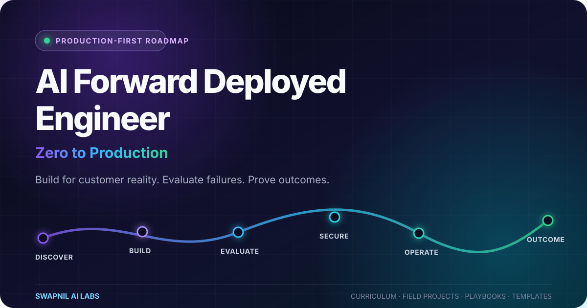
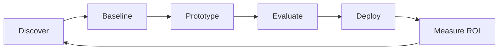

# AI Forward Deployed Engineer: Zero to Production

> A production-first, project-based path for engineers who want to turn ambiguous customer problems into secure, measurable AI systems.

[](./ROADMAP.md)
[](./projects/README.md)
[](./LICENSE)
[](./CONTRIBUTING.md)

Most AI roadmaps stop at “build a chatbot.” This one starts where demos usually fail: unclear requirements, messy data, permissions, evaluation, deployment, adoption, and business value.

The learning loop is simple:



Every module ends with evidence. Every project includes technical, operational, and customer-facing deliverables. The goal is not course completion. The goal is a portfolio you can demo, defend, and operate.

## AI System Design Handbook — start with clear explanations

The new **[AI System Design Handbook](./ai-system-design-handbook/README.md)** includes **26 plain-English chapters, 60 answered interview questions, seven worked architecture cases, five runnable offline Python labs, and eight working templates**. Follow the [eight-week study plan](./ai-system-design-handbook/ROADMAP.md), explore the [full topic index](./ai-system-design-handbook/INDEX.md), or [run the labs](./ai-system-design-handbook/labs/README.md). The examples use synthetic data, and the original explanations credit the learning guide that inspired the format.

## Practical learning collections

Explore **[six focused collections](./learning-collections/README.md)** that connect FDE preparation, AI architecture, current personal agents, and open-source implementation practice.

| Collection | Practical value |
|---|---|
| [FDE Field Drills](./learning-collections/fde-field-drills/README.md) | Three worked cases, answer keys, synthetic data, and an offline ticket-analysis tool |
| [AI System Design Patterns](./learning-collections/ai-system-design-patterns/README.md) | Eight architecture cards with diagrams, failure cases, and exercises |
| [Open-source AI Engineering](./learning-collections/open-source-ai-engineering/README.md) | 54 open-source entries across 14 categories, eight separately classified references, and a searchable Python catalog |
| [Meta Muse](./learning-collections/meta-muse-practical-guide/README.md) | First task, original playbooks, controls, and official product sources |
| [ChatGPT dots](./learning-collections/chatgpt-dots-practical-guide/README.md) | Setup, responsibilities, source access, five recipes, and outcome review |
| [Grok Bot](./learning-collections/grok-bot-practical-guide/README.md) | Bot roles, handoffs, routines, four playbooks, and troubleshooting |

All six use plain English and original exercises. The product guides distinguish documented behavior from proposed recipes; the catalog records documentation reviews rather than installation or benchmark claims. Start with the [same-task review worksheet](./learning-collections/SAME-TASK-REVIEW.md) if you want to compare products using consistent inputs.

## Why this roadmap exists

Current FDE roles ask engineers to embed with customers, scope ambiguous problems, build full-stack systems iteratively, plan production deployments, and return field feedback to product teams. Those expectations appear directly in current [OpenAI FDE role descriptions](https://openai.com/careers/forward-deployed-software-engineer-seattle-seattle/) and in Palantir's description of engineers who build alongside customers for rapid operational impact in its [FDSE field account](https://blog.palantir.com/a-day-in-the-life-of-a-palantir-forward-deployed-software-engineer-45ef2de257b1).

This repository turns that job shape into a learn-by-shipping system.

## What makes it production-first

| Typical roadmap | This playbook |
|---|---|
| Topics and links | Weekly outputs and acceptance tests |
| One polished happy path | Failure cases, fallbacks, and incident drills |
| Model accuracy only | Quality, latency, cost, safety, and adoption |
| Toy chatbot | Workflow integrated with real systems |
| Architecture diagram | Runnable slice plus operations pack |
| “Completed a course” | Demo, decision log, eval report, and ROI case |

## The FDE capability model

An effective AI FDE combines six capabilities:

1. **Discovery** — find the expensive bottleneck behind the initial request.
2. **Systems engineering** — build APIs, data flows, interfaces, and integrations that survive production.
3. **Applied AI** — select models, retrieval, tools, and orchestration based on constraints.
4. **Reliability and safety** — evaluate, observe, secure, and control probabilistic behavior.
5. **Deployment leadership** — ship inside the customer's cloud, data, identity, and compliance boundaries.
6. **Outcome ownership** — prove adoption and measurable value, then hand over a system the team can run.

Track your evidence in the [FDE readiness scorecard](./SCORECARD.md).

## Choose your route

| Route | Best for | Time | Start here |
|---|---|---:|---|
| Builder | Automation, data, or junior engineers | 16 weeks | [Start from Week 0](./START-HERE.md) |
| Accelerator | Working software/AI engineers | 8 weeks | Diagnose gaps, then complete Modules 04–11 |
| Interview sprint | Candidates with shipped projects | 4 weeks | Capstone hardening, case drills, system design |

The schedule is a planning default, not a promise. A module is complete only when its proof gate passes.

## Curriculum

| # | Module | Production evidence |
|---:|---|---|
| 00 | [Field mindset and discovery](./curriculum/00-field-mindset.md) | Problem brief, baseline, stakeholder map |
| 01 | [Python, APIs, and delivery quality](./curriculum/01-software-delivery.md) | Tested service with contract and CI |
| 02 | [Data and enterprise integration](./curriculum/02-data-integration.md) | Idempotent sync with audit trail |
| 03 | [Cloud, containers, and delivery](./curriculum/03-cloud-delivery.md) | Reproducible deployment and rollback |
| 04 | [LLM systems and model routing](./curriculum/04-llm-systems.md) | Model decision record and fallback |
| 05 | [Context engineering and RAG](./curriculum/05-rag-context.md) | Retrieval eval set and cited answers |
| 06 | [Agents and workflow automation](./curriculum/06-agents-automation.md) | Bounded agent with approvals and replay |
| 07 | [Evaluation engineering](./curriculum/07-evaluation.md) | Quality, safety, latency, and cost gates |
| 08 | [Security, privacy, and governance](./curriculum/08-security-governance.md) | Threat model and data-control matrix |
| 09 | [Observability and AI operations](./curriculum/09-observability-operations.md) | Dashboard, alerts, and incident drill |
| 10 | [Productization and adoption](./curriculum/10-product-adoption.md) | Pilot plan, adoption funnel, handoff pack |
| 11 | [Commercial thinking and executive communication](./curriculum/11-commercial-execution.md) | ROI model and executive readout |
| 12 | [Portfolio and interview loop](./curriculum/12-portfolio-interviews.md) | 10-minute demo and evidence-backed story |

## Field projects

Do one project deeply before attempting several superficially. Each blueprint requires a working vertical slice, evaluation report, security note, runbook, and outcome review.

| Project | Customer outcome | Hard production constraint |
|---|---|---|
| [RCM Denial Intelligence Copilot](./projects/01-rcm-denial-copilot.md) | Reduce manual denial triage and surface recoverable revenue | Sensitive data, citations, role-based access |
| [Collections Voice Agent](./projects/02-collections-voice-agent.md) | Increase promise-to-pay conversion without unsafe pressure | Consent, escalation, latency, call audit |
| [Recruiting Operations Agent](./projects/03-recruiting-operations-agent.md) | Cut screening and coordination time | Bias checks, PII, human decision ownership |
| [B2B Lead Intelligence System](./projects/04-lead-intelligence-system.md) | Improve qualified meetings per 100 accounts | Data provenance, deliverability, suppression |
| [Document Operations Pipeline](./projects/05-document-operations-pipeline.md) | Turn unstructured documents into review-ready records | Schema drift, confidence routing, replay |
| [Enterprise AI Control Plane](./projects/06-enterprise-ai-control-plane.md) | Standardize model access, policy, cost, and observability | Multi-tenancy, budgets, provider failure |

## The Definition of Done

A portfolio project is complete only when you can show:

- a one-page problem brief with a quantified baseline;
- a working end-to-end path using realistic test data;
- an evaluation dataset containing normal, edge, and adversarial cases;
- a threat model, permission boundaries, and data-retention decision;
- traces, cost and latency metrics, alerts, plus a tested rollback;
- an architecture decision record explaining at least one rejected alternative;
- an operator runbook and customer handoff notes;
- an outcome review separating measured results from assumptions.

Use the reusable [field playbooks](./playbooks/README.md) and [templates](./templates/README.md) instead of starting from blank pages.

## Repository map

```text
.
├── curriculum/       # 13 evidence-gated learning modules
├── projects/         # 6 production-grade portfolio blueprints
├── playbooks/        # Discovery-to-handoff field procedures
├── templates/        # Copyable briefs, eval plans, ADRs, and runbooks
├── learning-collections/ # Six focused FDE, design, agent, and open-source collections
├── .github/          # Contribution templates and automated checks
├── START-HERE.md     # Route selection and Week 0 setup
├── ROADMAP.md        # 16-week build sequence
└── SCORECARD.md      # Readiness assessment based on evidence
```

## Core tools, deliberately replaceable

The concepts matter more than any vendor. A practical default stack is Python, FastAPI, PostgreSQL, Docker, GitHub Actions, an LLM API, OpenTelemetry, and either n8n or code-native orchestration. Replace components when customer constraints demand it—and record the decision.

For n8n builders, the official [AI workflow evaluation guide](https://docs.n8n.io/build/integrate-ai/test-and-improve-ai-workflows/) is especially useful: test cases and metrics should be part of the workflow, not an afterthought.

## About the author

Created and maintained by **Swapnil Mandloi**, AI Automation Engineer and founder of [Swapnil AI Labs](https://swapnilailabs.netlify.app/). Swapnil builds production AI automations, voice agents, document-intelligence systems, and multi-step operational workflows.

- [Published n8n workflows](https://n8n.io/creators/swapnil-mandloi/)
- [Swapnil AI Labs](https://swapnilailabs.netlify.app/)

## Contributing

Corrections, field-tested examples, eval datasets, and deployment lessons are welcome. Read [CONTRIBUTING.md](./CONTRIBUTING.md) before opening a pull request. Never contribute customer secrets, personal data, private prompts, or proprietary documents.

## License and responsible use

Code and original written material in this repository are available under the [MIT License](./LICENSE). External resources remain subject to their own terms. Example business outcomes are targets unless explicitly labeled as measured; validate legal, security, compliance, and accessibility requirements for every real deployment.

---

**Build for the customer's reality. Measure what changes. Leave the system operable.**
