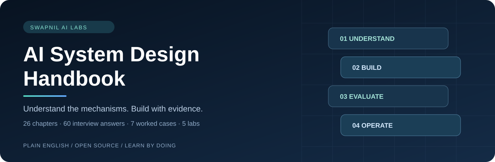

# AI System Design Handbook

**Clear explanations. Worked architectures. Code you can inspect.**

A free, practical handbook for learning how AI applications work, preparing for system-design interviews, and turning automation prototypes into dependable systems. Written in plain English, from first principles to production trade-offs.

[](INDEX.md)
[](interview/question-bank.md)
[](case-studies/README.md)
[](labs/README.md)
[](LICENSE)

[Start learning](START-HERE.md) · [All chapters](INDEX.md) · [Eight-week plan](ROADMAP.md) · [Run the labs](labs/README.md) · [Interview prep](interview/README.md)

## Start from a question you care about

| Your question | Start here |
|---|---|
| How is an LLM different from a complete AI system? | [AI without jargon](chapters/01-ai-without-jargon.md) |
| I know n8n. What do I need beyond connected nodes? | [n8n in production](chapters/17-n8n-in-production.md) |
| How do I answer questions over company documents? | [Production RAG](chapters/13-production-rag.md) |
| How can an agent use tools without exceeding its authority? | [Workflows](chapters/14-workflows-and-agents.md) → [Tool boundaries](chapters/15-tools-and-mcp.md) |
| How do I know a change actually improved the system? | [Evaluation](chapters/18-evaluation.md) |
| How do I prepare for an interview? | [60 worked answers](interview/question-bank.md) → [Timed framework](interview/answer-framework.md) |
| How do I calculate scale and cost? | [Requirements](chapters/03-requirements-and-capacity.md) → [Economics](chapters/23-cost-and-economics.md) |
| How do I show practical ability? | [Capstone](CAPSTONE.md) → [Working templates](templates/README.md) |

## How the explanations work

Each chapter introduces a concept in ordinary language, connects it to an everyday analogy, works through an example, and examines the decisions and failures it creates. Practice questions include suggested answers. Important terms link to a [plain-English glossary](GLOSSARY.md).

The running examples include support policies, invoices, marketing metrics, research records, healthcare operations, code changes, and appointments. They make abstract topics concrete without assuming advanced mathematics or prior ML training. Basic Python helps with the labs; the [API/SQL bridge](chapters/02-python-api-sql.md) explains the starting vocabulary.

## The curriculum

| Stage | Chapters | What you should be able to explain |
|---|---|---|
| Foundations | 1–4 | Model versus application, APIs/SQL, requirements, capacity, distributed failures |
| Model engineering | 5–9 | Tokens, transformers, selection, context, adaptation, serving |
| Retrieval systems | 10–13 | Parsing, versions, chunks, embeddings, search, reranking, grounded answers |
| Actions and automation | 14–17 | Workflows, agents, tools/MCP, memory, durable state, n8n |
| Production engineering | 18–23 | Evaluation, access, privacy, reliability, observability, release, economics |
| Applied delivery | 24–26 | Voice/multimodal systems, predictive ML, discovery, pilot, handoff |

Use [the full index](INDEX.md) for every chapter and prerequisite. Follow [the roadmap](ROADMAP.md) if you prefer a daily sequence.

## Run something in five minutes

This handbook is published in the `ai-system-design-handbook/` folder of the AI FDE repository. Download the repository with **Code → Download ZIP**, extract it, and open a terminal in this handbook folder (the one containing `labs/`). If your terminal starts in the parent FDE repository, run `cd ai-system-design-handbook` first. Use Python 3.11 or newer. On Windows, `py` may replace `python`; on macOS/Linux, use `python3` if needed.

```bash
python -m labs.mini_rag --question "What is the refund window?" --tenant acme
python -m labs.evaluate
python -m labs.guarded_workflow --approve
python -m labs.capacity
python -m labs.gateway
python -m unittest discover -s tests -v
python scripts/check_docs.py
```

No API key or third-party Python package is needed. [The lab guide](labs/README.md) explains expected outputs, code-reading order, exercises, and gaps to address before using the mechanisms in a real service.

The retrieval lab uses lexical, extractive evidence. The gateway uses simulated providers. The invoice lab writes to a local SQLite ledger. These choices make the mechanisms reproducible and inspectable; they do not represent complete deployed LLM integrations.

## Seven worked architectures

| Case | Key design problem |
|---|---|
| [Support knowledge assistant](case-studies/01-support-assistant.md) | Current evidence, exceptions, and tenant isolation |
| [Invoice operations](case-studies/02-invoice-operations.md) | Extraction, review, duplicate prevention, reconciliation |
| [Marketing analytics assistant](case-studies/03-marketing-analytics.md) | Exact numbers, compatible grain, and supported interpretation |
| [Lead research workbench](case-studies/04-lead-research.md) | Provenance, contact uncertainty, and reviewed drafts |
| [Healthcare operations copilot](case-studies/05-healthcare-operations.md) | Sensitive evidence and carefully defined metrics |
| [Coding assistant](case-studies/06-coding-assistant.md) | Scoped tools, isolated changes, and validation evidence |
| [Appointment voice assistant](case-studies/07-voice-assistant.md) | Turn-taking, critical entities, and transaction state |

All case-study volumes, targets, and rates are fictional design assumptions. All bundled records are synthetic. Use cases are exercises, not claims about client deployments, compliance, or measured business outcomes.

## Apply the concepts in focused collections

Continue with [eight system-design pattern cards](https://github.com/swapnilmandloi312/ai-forward-deployed-engineer-zero-to-production/tree/main/learning-collections/ai-system-design-patterns), [three worked FDE field drills](https://github.com/swapnilmandloi312/ai-forward-deployed-engineer-zero-to-production/tree/main/learning-collections/fde-field-drills), and the [open-source AI Engineering catalog](https://github.com/swapnilmandloi312/ai-forward-deployed-engineer-zero-to-production/tree/main/learning-collections/open-source-ai-engineering). Each connects a design choice with an exercise and an observable failure case.

For current personal-agent interfaces, read the independent guides to [Meta Muse](https://github.com/swapnilmandloi312/ai-forward-deployed-engineer-zero-to-production/tree/main/learning-collections/meta-muse-practical-guide), [ChatGPT dots](https://github.com/swapnilmandloi312/ai-forward-deployed-engineer-zero-to-production/tree/main/learning-collections/chatgpt-dots-practical-guide), and [Grok Bot](https://github.com/swapnilmandloi312/ai-forward-deployed-engineer-zero-to-production/tree/main/learning-collections/grok-bot-practical-guide). They link official documentation and use original proposed tasks; no signed-in execution results are claimed. Browse [all six collections](https://github.com/swapnilmandloi312/ai-forward-deployed-engineer-zero-to-production/tree/main/learning-collections) to choose a learning route.

## Study, practice, and contribute

- Use [the revision sheet](CHEATSHEET.md) to recall calculations and failure diagnosis.
- Copy [eight working templates](templates/README.md) into your own project.
- Test a complete explanation with [the interview rubric](interview/rubric.md).
- Find setup help in [troubleshooting](TROUBLESHOOTING.md).
- Improve explanations or add a carefully scoped example using [the contribution guide](CONTRIBUTING.md).

The handbook focuses on durable engineering concepts. Model prices, APIs, protocols, deployment features, and laws can change. [Resources and provenance](RESOURCES.md) distinguishes primary documentation from the repository that inspired this format. Verify provider-specific details against the current official source before a real integration.

## Maintainer and acknowledgments

Maintained by **[Swapnil Mandloi](https://github.com/swapnilmandloi312)** · **[Swapnil AI Labs](https://swapnilailabs.netlify.app/)** · [Published n8n workflows](https://n8n.io/creators/swapnil-mandloi/).

Inspired by the learning-reference format of [Om Bharatiya's AI System Design Guide](https://github.com/ombharatiya/ai-system-design-guide). The explanations, exercises, fictional scenarios, and lab implementations in this handbook were prepared independently for this project. See [ACKNOWLEDGMENTS.md](ACKNOWLEDGMENTS.md).

Original repository content is available under the [MIT License](LICENSE). External resources retain their own licenses and terms.
