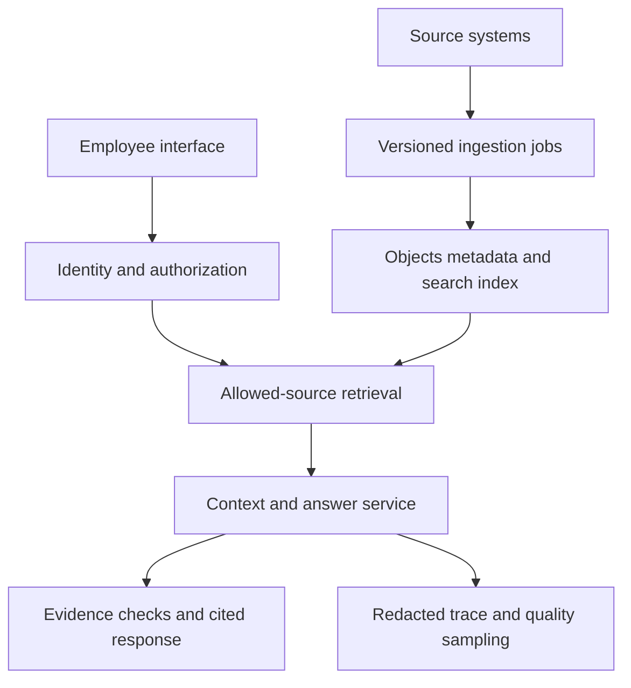

# Case 1 · A support knowledge assistant for multiple businesses

## 1. Clarify the request

Design an assistant that answers employees' product-policy questions using their company's documents. It returns sources and can prepare a support reply. It does not issue refunds or change accounts.

**Fictional assumptions:** 50 companies, 100,000 documents total, 12,000 questions/day, estimated peak two questions/second, and a five-second p95 complete-response target. Policy updates should become searchable within 15 minutes. Permission revocations must be honored before further content is exposed.

Ask about document formats, languages, identity provider, access groups, source freshness, acceptable refusal behavior, and approved model providers. Resolve whether a policy varies by region, product, or effective date.

## 2. Architecture

Ingestion preserves original files, parser versions, document/access metadata, and chunk versions. Serving applies trusted user scope, retrieves current eligible evidence, combines/reranks candidates, and asks the model to answer with source references. Output checks verify references and required behavior; sampled semantic review checks support.

## 3. Data and API contract

Document records include tenant, source ID, version, effective date, status, access groups, checksum, and source URI. Chunk records add chunk ID, page/section, text, and embedding version. Query records capture a safe question reference, release configuration, selected chunk IDs, usage, timing, and outcome category.

`POST /questions` accepts a question and optional conversation ID. Tenant and user scope come from the session. Response fields include answer, citations with document/version/section, answerability outcome, and request ID. A refusal or clarification is a supported outcome, not an exception to hide.

## 4. Work through an exception

A customer policy says returns are allowed for 30 days, except opened electronics, which have a 14-day limit. An employee asks about opened headphones after 20 days. The answer needs the exception, not just the general page. Test both retrieval coverage and whether the final answer applies the exception.

If two active sources conflict, use a documented precedence rule when one exists. Otherwise show the conflict and route to the policy owner. A model should not quietly choose the more convenient policy.

## 5. Capacity and trade-offs

At peak two requests/second and four-second mean in-flight time, estimate eight concurrent requests before headroom. Verify token quotas and slow-tail cases. Keep index size estimates separate from text, metadata, replicas, and cache storage.

Compare keyword-only, dense, and hybrid retrieval on a labeled set. A small database with vector support may be operationally simpler than adding another store; a specialized search service may fit different scaling or relevance needs. Choose using measurements and ownership, not a universal vendor ranking.

## 6. Failure and recovery

| Failure | Detection | Recovery |
|---|---|---|
| Parser produces empty text | Coverage checks | Quarantine and inspect original |
| Old answer after update | Chunk-version trace | Activate correct index and invalidate cache |
| Provider outage | Timeout/error indicators | Approved fallback or source-only response |
| Cross-tenant request | Negative tests and access audit | Deny before content exposure; investigate |
| Unsupported claim | Semantic review | Improve context/prompt and add regression case |

## 7. Evaluation and rollout

Create 200 synthetic labeled questions covering direct facts, exceptions, missing information, conflicts, stale sources, and denied access. Report slice quality, citation support, abstention, latency, and cost. Set thresholds before selecting a model. Start with a small employee pilot; record correction effort and whether prepared replies are accepted.

**Extension:** design permission-aware cache invalidation when an employee changes teams. Explain the stale-result window, current authorization check, and cache-key/version strategy.

Related: [RAG chapter](../chapters/13-production-rag.md), [retrieval lab](../labs/README.md).
