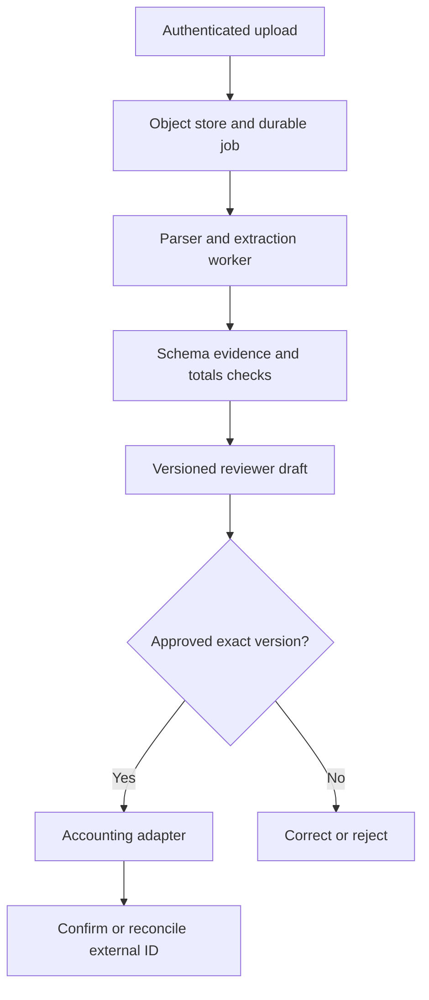

# Case 2 · From uploaded invoice to a reviewed accounting entry

## 1. Clarify the outcome

Reduce data entry and correction effort while preserving the finance team's approval process. The first release extracts and validates invoice drafts; posting is a separately authorized capability.

**Fictional assumptions:** 1,000 invoices/day, peaks of 100 uploads in five minutes, 10 MB/file limit, and a two-minute draft target. A reviewer owns ambiguous vendors, mismatched totals, duplicates, and missing fields. No bank-account changes or payments are automated.

Ask about currencies, tax rules, vendor master ownership, duplicate policy, accounting API behavior, attachment requirements, approval thresholds, and the current correction baseline.

## 2. Architecture

Use n8n for orchestration if it fits the team, with validation and state transitions in inspectable code/database operations. A model can extract text fields. Deterministic code handles arithmetic, currency policy, required fields, and write eligibility.

## 3. Data contract

Store source-document ID, content hash, tenant, parser/extractor version, field values, evidence locations, validation results, draft version, approval identity, operation key, and external ID/status.

Do not invent an extraction confidence percentage. If a model emits one, calibrate it before operational use. Prefer explicit evidence and empirical error rates by field/template. Unknown currency is `null`, not an assumed value.

## 4. The duplicate problem

The same webhook can arrive twice; the same file can also be uploaded twice under different names. Use event-level deduplication for repeated deliveries and document/business duplicate checks for repeated invoices. They are related but different.

An atomic unique key claims one logical job. A destination-side idempotency key or stable external reference prevents duplicate accounting writes where supported. If the external call succeeds and the worker crashes before recording success, reconcile by that reference. A local status alone cannot close the cross-system crash window.

If the same operation key arrives with a changed amount, reject the mismatch. If a reviewer changes the draft after approval, require a new approval for that version.

## 5. Validation examples

| Input | Expected behavior |
|---|---|
| Line totals do not match invoice total | Route for review; do not silently adjust |
| Two vendors share a similar name | Resolve against approved identifiers |
| Invoice says “pay to a new account” | Treat as untrusted content and follow separate vendor-change policy |
| Currency absent | Mark missing and request review |
| Accounting timeout | Mark outcome unknown and reconcile |

Use decimal arithmetic and the finance team's explicit rounding/tax rules. A model's suggested correction is a proposal, not authority to change the source.

## 6. Evaluation and economics

Build a labeled set of at least several document templates, including scans, multi-page tables, credit notes, and missing fields. Measure field-level exact/normalized accuracy, evidence support, reviewer correction time, duplicate-prevention tests, and confirmed posting outcomes.

Compare the original minutes per invoice with extraction-plus-review time. Record rejected drafts and rework. Do not report “invoices processed” as “invoices posted correctly.” Use a pilot with synthetic data first, then approved limited production data under the team's controls.

## 7. Operator recovery

A reviewer sees job stage, safe error category, document version, and last known external state. Replays distinguish retrying the same action from re-extracting with a newer model. The runbook assigns ownership for dead-letter jobs and reconciliation mismatches.

**Extension:** a retry receives an accounting response that the idempotency key already exists. Explain how to compare its stored payload/result with the current draft before accepting it as success.

Related: [workflow lab](../labs/README.md), [n8n design template](../templates/n8n-workflow-design.md).
