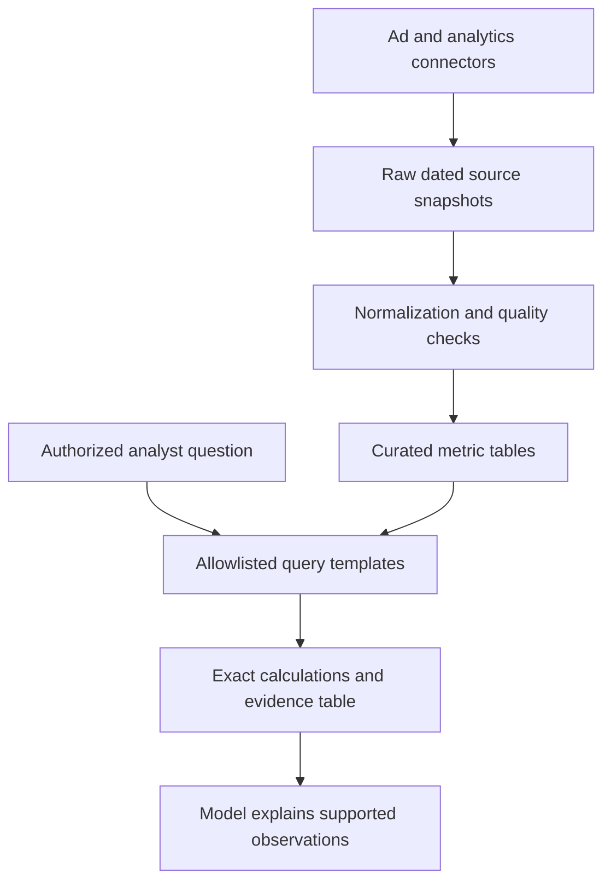

# Case 3 · A marketing analytics assistant that does not invent numbers

## 1. Clarify the decision

The marketing team wants to understand spend, enquiries, and campaign changes across ad platforms and website analytics. The assistant explains validated metrics and drafts observations. It does not automatically change ad budgets.

**Fictional assumptions:** 20 client accounts, daily refresh, 24 months of data, and a ten-second analysis response target for curated questions. The business must define an enquiry and choose its reporting timezone and currency policy.

Ask which conversions count, how attribution differs across platforms, whether refunds/invalid leads are excluded, and which source is authoritative for each metric. “Google leads” and “CRM qualified opportunities” are not interchangeable.

## 2. Architecture

Use scheduled jobs to extract paginated source data, with watermarks and a lookback for revised attribution. Preserve raw snapshots and retrieval times. Curated tables standardize date, account, campaign, currency, metric definition, and source.

## 3. Metric contract

For each metric, define grain, numerator, denominator, dimensions, timezone, source, refresh schedule, attribution window, exclusions, and owner. A campaign/day table cannot answer an individual-lead question that requires CRM-level data.

Cost per enquiry is `spend / enquiries`, with a defined result when enquiries are zero. Aggregate ratios from their components: sum spend divided by sum enquiries. Averaging daily cost-per-enquiry values usually gives a different and misleading monthly value.

Example: day one spends $100 for one enquiry; day two spends $100 for ten. The average daily ratio is `$55`, but the correct combined ratio is `$200 / 11 ≈ $18.18` under this definition.

## 4. Guard the analysis path

Map supported question types to parameterized query templates or a restricted semantic layer. If free-form SQL generation is introduced, use read-only credentials, allowed views, query parsing/policy checks, time/row limits, and access enforcement. Do not let the model run arbitrary SQL against a production database.

Return the result table and query/version metadata before asking the model to explain it. Validate every number in the narrative against those results where possible. If the needed metric is unavailable, state the gap rather than fill it with an estimate presented as fact.

## 5. Observation is not causation

“Spend rose while enquiries fell” is an observation. “The new ad creative caused the decline” needs stronger evidence. Attribution differences, tracking outages, seasonality, delayed conversions, and changes in lead quality are competing explanations.

The assistant can propose checks and experiments. It should label hypotheses and distinguish them from confirmed findings. A model should not convert correlation into a confident budget recommendation.

## 6. Failure and evaluation

Test missing dates, duplicated API pages, account timezone boundaries, late attribution updates, currency mismatches, zero denominators, and unauthorized account requests. Compare calculations with trusted reports and known SQL fixtures.

Evaluate numeric correctness, definition adherence, supported observations, and uncertainty handling. Track freshness and failed connectors separately from explanation quality. During source failures, show the most recent successful refresh time prominently.

## 7. Rollout

Begin with a small library of high-value questions: spend by month, enquiries by landing page, campaign changes, and source reconciliation. Let analysts review drafts before distribution. Measure time saved on accepted analyses and corrections—not merely the number of generated paragraphs.

**Extension:** design a report for landing page × keyword × location × month. Explain which sources can provide those dimensions at a compatible grain and how you would expose missing joins without fabricating detail.

Related: [SQL foundation](../chapters/02-python-api-sql.md), [ROI worksheet](../templates/roi-worksheet.md).
