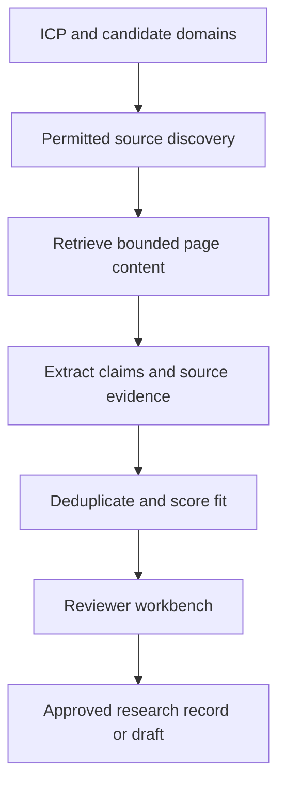

# Case 4 · A lead research workbench with evidence

## 1. Clarify the outcome

Help a researcher identify organizations that match a precise ideal customer profile and prepare evidence-backed notes. The first version prepares records and drafts; it does not automatically send messages.

**Fictional assumptions:** 100 candidate organizations/day, five research sources per organization, and a human review step before any outreach. Contacts are limited to appropriately sourced business information under the applicable collection and outreach rules.

Define industry, geography, organization size, trigger events, excluded segments, and a useful problem hypothesis. An expensive-looking company is not automatically a good fit for a particular service.

## 2. Architecture

Keep fetching separate from extraction. Respect source access restrictions, rate limits, and applicable terms. Do not treat text retrieved from a website as instructions to use tools or reveal stored contacts.

## 3. Evidence contract

Each claim stores value, exact source URL, observed date, source text/span, and verification status. Separate company facts from inferred needs. “The company has offices in three countries” may be sourced. “They lose ten hours every week on onboarding” is a hypothesis unless someone provides evidence.

For an email, distinguish syntax validity, domain/MX checks, publication on an official page, explicit confirmation, and delivery history. Finding an address on a website does not prove that the mailbox currently accepts mail or belongs to the intended person. Never label a guessed pattern as verified.

Use statuses such as `officially_published`, `unconfirmed`, and `not_found`, with a method/date field. A null email is better than an invented address. Role inboxes may be usable for an appropriate purpose, but do not pretend they identify a particular decision maker.

## 4. Fit and prioritization

Use a transparent rubric: segment match, evidence of a relevant workflow, source quality, and reachable business channel. Keep confidence in evidence separate from attractiveness of the account. A model-generated probability needs calibration; an arbitrary 92/100 should not masquerade as measured likelihood.

For example, a company hiring three finance-operations roles may justify investigating invoice workflows. It does not prove they want automation or are struggling. A useful outreach draft states a relevant observation and asks whether the workflow is a priority.

## 5. Failure modes

| Failure | Better behavior |
|---|---|
| Search result refers to a namesake | Confirm domain and organization identity |
| Person has changed roles | Record freshness and seek current official evidence |
| Model guesses email format | Store unconfirmed/null; do not mark verified |
| Draft asserts imaginary pain | Label it as a hypothesis or remove it |
| Duplicate records trigger repeat contact | Deduplicate and maintain suppression/history |

## 6. Evaluation

Sample records for entity identity, ICP fit, evidence support, contact provenance, duplicates, and false claims. Measure reviewer acceptance and qualified conversations only after an appropriately authorized outreach process exists. Draft volume alone is not business success.

Include source-unavailable and no-email examples in evaluation. A system pressured to fill every field will often fabricate. Design completion to allow “not found with searched sources recorded.”

## 7. Human handoff

The reviewer can inspect the source, edit the hypothesis, remove a contact, and apply suppression. Store approved draft versions separately from collected facts. Sending requires its own explicit authorization, destination checks, and applicable requirements.

**Extension:** how should the workbench handle a contact published two years ago on a conference page and absent from the current company website? Explain the status, evidence, and next permitted verification step.

Related: [security](../chapters/19-security-and-access.md), [problem brief](../templates/problem-brief.md).
