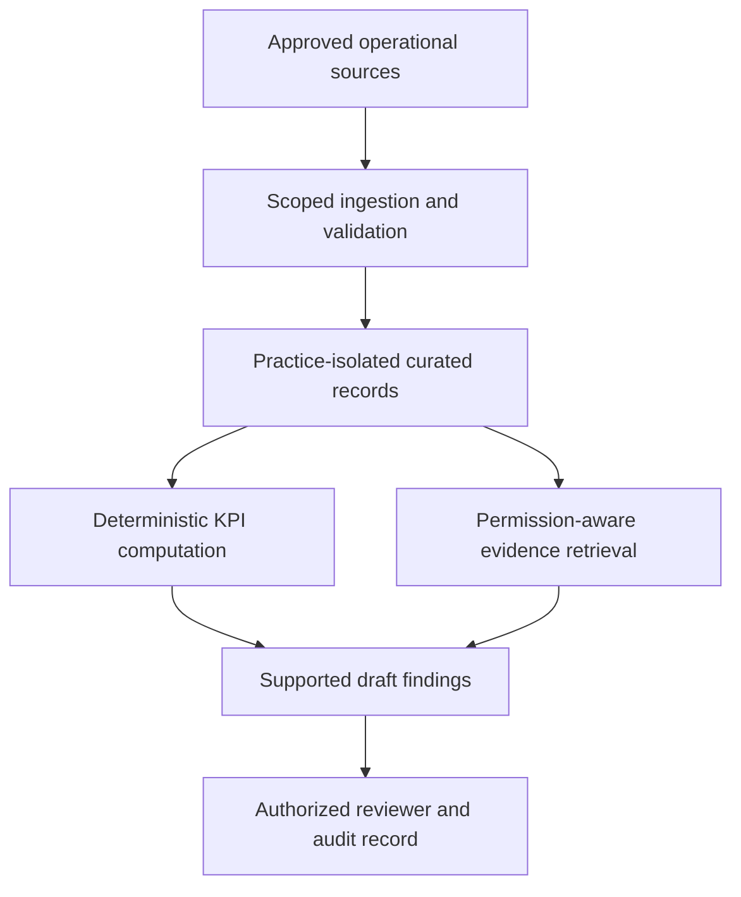

# Case 5 · A healthcare revenue-operations copilot

## 1. Scope the job carefully

Design a tool that helps authorized revenue-operations staff investigate claim denials and prepare operational findings. It is not a clinical diagnosis system, a legal determination, or an autonomous payer-appeal service.

**Fictional assumptions:** five practices, 50,000 claim events/month, daily source refresh, and a reviewed weekly operations report. The bundled exercise uses synthetic records only. A real deployment requires organization-specific privacy, security, contractual, and compliance decisions before processing sensitive information.

Ask which systems contain claims, remittances, eligibility, credentialing, and staff actions. Determine who can access which practice, whether identifiers are needed for the task, how denial categories are defined, and which actions require an experienced reviewer.

## 2. Architecture

Keep exact metrics in SQL or tested computation. Use retrieval for definitions, approved procedures, and source explanations. The model turns those results into a draft with traceable supporting records and explicit limitations.

## 3. Counts require definitions

A “claim” may have multiple submissions, events, lines, and denial reasons. Counting rows can inflate affected-claim totals. Define the grain and deduplication key. Distinguish denied claim count, denied line count, denied amount, and unresolved backlog.

Suppose 55 unique synthetic claims are associated with credentialing reasons. That supports a count under the stated rule; it does not prove every denial has the same root cause or that every dollar is recoverable. Investigate payer, provider, dates, reason codes, enrollment status, and correction history.

For eligibility, separate missing verification, coverage mismatch, expired coverage, documentation gaps, and source uncertainty where the data supports it. Preserve an “unclassified” bucket instead of forcing every event into a confident category.

## 4. Evidence and recommendation contract

A finding includes period, practice scope, metric definition, relevant records, source timestamp, interpretation, proposed action, owner, and review status. A recommendation such as “review provider enrollment status for this segment” is distinct from an asserted cause or an instruction to submit an appeal.

Use the minimum necessary data in generated text and traces. Aggregate reports may still reveal sensitive information when groups are small. Review export access, source links, retention, and downstream distribution.

## 5. Threats and failures

Test cross-practice access, repeated claim events, delayed remittances, mixed date conventions, missing reason mappings, source-system corrections, and unsupported generated recommendations. Verify the approved provider/data path rather than assuming a generic API configuration is suitable.

If a source feed is stale, show its last successful refresh. If a KPI cannot be calculated from the available grain, explain the missing data. Do not let the model manufacture a dashboard number to make the report feel complete.

## 6. Evaluation and pilot

Use synthetic fixtures with known unique counts and amounts. Have qualified reviewers label denial interpretations and acceptable operational suggestions. Evaluate numeric accuracy, evidence support, authorization, sensitive-data exposure, and reviewer correction effort.

Pilot with a limited authorized group after required organizational approvals. Measure investigation time and accepted findings. Avoid claiming improved collections or recovered revenue without observed downstream outcomes and a defensible comparison.

**Extension:** a dashboard shows 55 credentialing denials but an export has 72 rows. Propose an investigation using grain, line/event duplication, time filters, and source versions before concluding either number is wrong.

Related: [analytics case](03-marketing-analytics.md), [evaluation plan](../templates/evaluation-plan.md).
