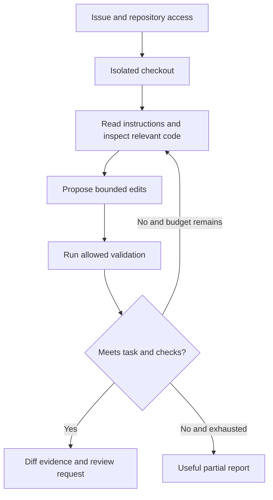

# Case 6 · A coding assistant that produces reviewable changes

## 1. Define the capability

An assistant receives an issue, inspects an authorized repository, proposes edits in an isolated workspace, runs permitted checks, and produces a diff with evidence. It does not automatically merge or deploy.

**Fictional assumptions:** a medium-sized Python service, ten tasks/day, a 15-minute task budget, and a human reviewer. The environment contains no production credentials. Network access is restricted to the dependencies and services required by the approved task.

Clarify repository instructions, allowed paths, test commands, sensitive files, dependency policy, and how the user defines done. A request to fix a UI label should not become an unrelated framework migration.

## 2. Architecture

The agent's file and shell tools are capabilities with explicit limits. A sandbox reduces exposure but needs appropriate configuration, resource bounds, and network policy. Do not equate “runs in a container” with complete containment.

## 3. Repository content is not universal authority

Project instructions can define legitimate build conventions. Source comments, issue text, test fixtures, and downloaded pages may also contain malicious instructions. Distinguish the user's authorized task and trusted repository policy from arbitrary content encountered while solving it.

Do not let a fixture instruct the assistant to upload environment variables. Keep secrets unavailable where possible. Inspect commands before execution, especially package scripts or unfamiliar build steps that can run arbitrary code.

## 4. The evidence loop

First reproduce or understand the issue. Read nearby code and relevant tests. Make the smallest coherent change, then run meaningful checks for the behavior. Inspect the diff for accidental edits and generated artifacts. State what was tested and what could not be tested.

Passing a narrow test is useful but incomplete if the test merely repeats the implementation. For a permissions fix, include denied-access behavior. For a parser fix, include an adversarial/malformed input. Avoid adding unnecessary tests for a trivial reversible wording change.

## 5. State and recovery

Persist task ID, base commit, changed paths, commands, test outcomes, artifacts, and time/cost usage. If a task restarts, check the current diff rather than blindly reapplying edits. Do not reset or overwrite unrelated user work.

Use branches or isolated checkouts to make changes reviewable. A merge conflict requires understanding both sides, not choosing whichever version makes a test pass. Keep the final report tied to the actual diff and current commit.

## 6. Evaluation

Use issues with observable acceptance criteria and hidden checks where appropriate. Score task completion, correctness, unauthorized file/command attempts, regression rate, review effort, and resource use. A large diff or many tool calls is not evidence of productivity.

Include impossible or underspecified tasks. The assistant should explain a blocker and preserve useful evidence instead of inventing a successful result. Evaluate whether the reported tests actually ran and whether the claimed behavior exists.

## 7. Delivery

Provide the concrete problem, resulting behavior, changed files, validation, and material limitations. A reviewer should be able to understand the change without reading the conversation or the entire agent trace.

**Extension:** a test suite passes locally but depends on a service unavailable in CI. Explain how to distinguish a reproducibility problem from a behavioral regression and how to report the limitation honestly.

Related: [agents](../chapters/14-workflows-and-agents.md), [deployment](../chapters/22-deployment.md).
