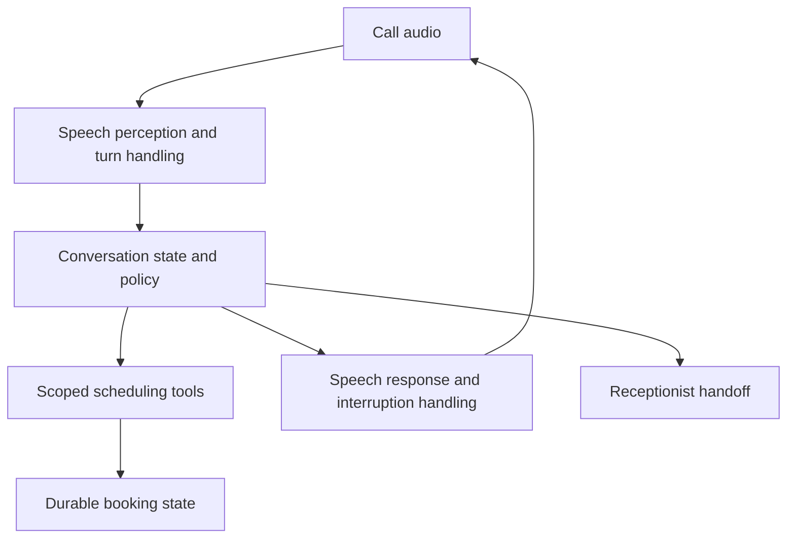

# Case 7 · An appointment voice assistant

## 1. Clarify the outcome

Help a caller find an available appointment and prepare or confirm a booking through an authorized scheduling system. It handles general scheduling rather than medical advice or emergency triage. Any real sensitive-data deployment needs its own organizational controls and approved providers.

**Fictional assumptions:** 100 calls/day, two supported languages, five-minute average call duration, and a receptionist escalation path. Booking rules, identity checks, recording policy, and confirmation requirements come from the organization.

Ask how callers identify themselves, which information may be spoken, whether calls may be recorded, what happens after business hours, and which cancellation/rescheduling actions require verification.

## 2. Architecture

A cascade can separate speech recognition, language reasoning, and synthesis. A direct audio model can reduce some boundaries. Evaluate both on complete task performance, critical-entity accuracy, latency, control, and operational cost.

## 3. A complete interaction

The caller requests Friday afternoon. The assistant resolves the date and timezone, checks allowed availability, offers real slots, verifies the selected slot and required identity details, and submits a booking under a stable operation ID. It speaks a confirmation only after the scheduling system confirms the outcome.

If the caller says “Actually, make that next Friday” while audio is playing, stop or revise playback and update the proposed state. If the earlier booking already succeeded, explain and use the authorized rescheduling procedure. Canceling speech does not undo a transaction.

## 4. Entity and action validation

Names, phone numbers, dates, and identifiers deserve targeted checks. Repeat or confirm critical details under the organization's policy. A low-confidence transcript should trigger clarification, but transcript confidence itself may be uncalibrated or unavailable; use empirical error analysis and task checks.

The model cannot invent a slot. The scheduling API controls availability, and booking may fail if somebody else takes it first. Handle that race by offering fresh alternatives, not promising a time from cached results.

## 5. Failure paths

| Failure | User-facing behavior | Durable behavior |
|---|---|---|
| Speech is unclear | Ask a focused clarification | Preserve known verified fields |
| Caller interrupts | Stop/revise playback | Keep action state accurate |
| Scheduling timeout | Explain uncertainty | Reconcile stable operation ID |
| No suitable slot | Offer allowed alternatives/handoff | Do not create an imaginary booking |
| Identity check fails | Follow organization policy | Deny protected information/actions |

Escalation needs a useful summary of verified facts, unresolved questions, and completed actions. Do not claim that a receptionist accepted the handoff unless it actually occurred.

## 6. Evaluation and rollout

Use synthetic scripted conversations covering accents, noise, corrections, interruptions, unavailable slots, duplicate requests, and denied access. Measure end-of-turn to first useful audio, critical-entity errors, booking correctness, escalation success, and cost per accepted booking.

Test recorded simulations before a limited supervised pilot under the required organizational permissions. Monitor task outcomes and review effort. A natural-sounding voice can conceal incorrect actions, so evaluate transaction results separately from conversational pleasantness.

**Extension:** a caller hangs up after the booking request but before spoken confirmation. Explain how the system reconciles the booking and what follow-up, if any, is permitted by the organization's policy.

Related: [voice chapter](../chapters/24-voice-and-multimodal.md), [incident runbook](../templates/incident-runbook.md).
