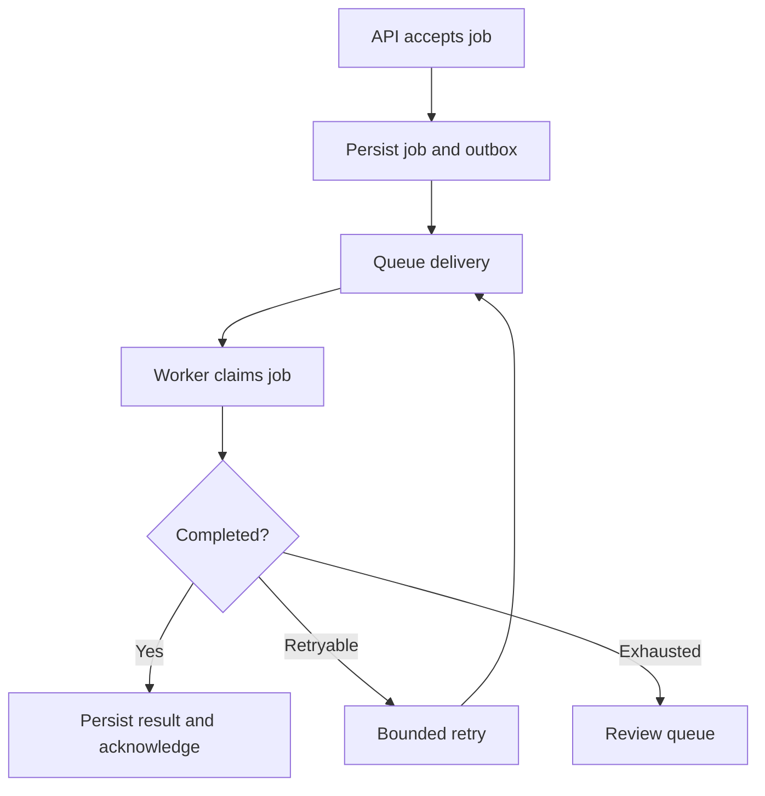

# 04 · Distributed systems without the mystery

**Prerequisites:** Chapters 2–3. **Goal:** understand why a successful demo can fail under real traffic.

## More than one process means more failure modes

A deployed AI feature may depend on an API service, a database, object storage, a queue, workers, and a model provider. Each can slow down, fail, or disagree temporarily. Distributed system design is largely about controlling these partial failures.

**Everyday intuition:** a courier may deliver a parcel even if the delivery confirmation gets lost. Sending another parcel can create a duplicate. A network timeout creates the same uncertainty.

## Queue and worker lifecycle

The outbox is a durable table of events written in the same database transaction as business state. A separate publisher sends these events to the queue. This avoids the gap where the database commit succeeds but publishing fails. The publisher can still send an event more than once, so the consumer must deduplicate.

## At-least-once and idempotency

At-least-once delivery means a job can arrive more than once. Idempotency means repeating the same logical operation has the same business effect as performing it once. A stable key, a uniqueness constraint, request-payload validation, and a durable result record help implement it.

For external effects, a local “done” flag is insufficient: the external call can succeed just before the local write crashes. Use the destination's idempotency support when available, reconcile using a stable external reference, and define manual recovery when the final outcome is ambiguous. Do not claim universal exactly-once execution across unrelated services.

## Timeouts, retries, and backpressure

Every remote operation needs a deadline. Retry transient failures with exponential backoff and jitter, within an overall attempt and time budget. Do not blindly retry invalid input or an action whose outcome is uncertain. If every layer retries three times, nested retries can multiply traffic dramatically.

Backpressure means slowing or rejecting new work when the system cannot keep up. Use a bounded queue, per-tenant limits, maximum in-flight requests, and a clear overload response. An infinitely growing queue converts overload into hours of invisible delay.

## Consistency and caching

A replica or cache may lag the primary database. That can be acceptable for a daily dashboard but dangerous for permission revocation or duplicate payment prevention. Decide which reads require current authoritative state.

A cache key must include every input that changes the result: tenant, user permissions where relevant, question, document version, model/prompt version, and locale. A global question-to-answer cache can leak one tenant's answer to another. A time-to-live alone does not solve revocation.

## Practice

A worker creates an accounting invoice, then crashes before storing the external ID. Describe what a retry should do. A strong answer uses a stable operation key and destination-side deduplication or a reconciliation lookup before another create attempt.

**Design check:** where is business state durable, which actions can repeat, and who owns jobs that cannot be resolved automatically?

Further reading: [PostgreSQL transaction isolation](https://www.postgresql.org/docs/current/transaction-iso.html).

Next: [Tokens and transformers](05-tokens-and-transformers.md) · [Index](../INDEX.md)
