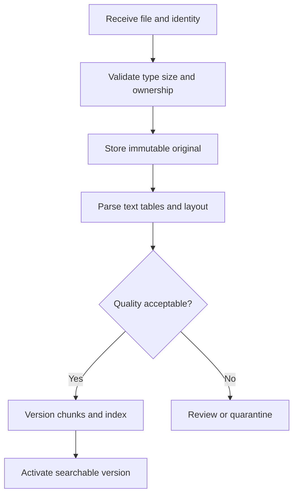

# 10 · From messy documents to trustworthy evidence

**Prerequisites:** Chapters 2 and 4. **Goal:** build the data pipeline that makes retrieval useful.

## The answer can only be as good as the source pipeline

Document ingestion converts files or remote records into searchable, versioned material. It includes acquisition, validation, parsing, cleaning, chunking, indexing, and update/delete propagation. It is not simply “upload PDF to a vector database.”

**Everyday intuition:** a library catalog is useless when books have missing pages, wrong titles, or outdated editions.

## Trace a single file

Keep the original object and its checksum. Create a job record with tenant, source ID, parser version, timestamps, and status. Validate actual content type rather than trusting a filename extension. Bound file sizes, decompression, pages, and processing time to avoid resource exhaustion.

## Parsing is not one problem

Digital PDFs may contain selectable text but ambiguous reading order. Scanned PDFs need OCR. Tables need preserved headers and relationships. Slides may place a crucial qualifier in a small text box. A vision model can help, but its output still needs source coordinates and evaluation.

For an invoice table, extracting “Quantity: 2” and “Unit price: 50” into disconnected paragraphs loses the relationship that yields the total. Preserve row and column context or create a structured table representation. Record page/section references so a reviewer can inspect the original.

## Useful metadata

| Field | Reason |
|---|---|
| `tenant_id`, `document_id`, `version` | Ownership and update identity |
| `source_uri`, `page`, `section` | Traceable citations |
| `content_hash`, `parser_version` | Reproducibility and deduplication |
| `valid_from`, `valid_to`, `status` | Current-policy selection |
| `access_groups`, `classification` | Permission enforcement |
| `ingested_at`, `source_updated_at` | Freshness and pipeline delay |

Metadata is part of the evidence contract. If access groups disappear during chunking, authorization later becomes unreliable.

## Updates and deletions

Index a new document version without exposing half of its chunks. After validation, switch an active-version pointer or an equivalent transactional visibility mechanism. Retire the old version from new queries while keeping an audit record according to the retention policy.

A source deletion must propagate to raw objects, parsed text, chunks, search indexes, caches, and derived stores where applicable. Define how backups and audit retention work with the actual organization. An index delete alone is not the whole lifecycle.

For permission changes, avoid waiting for a nightly reindex before honoring revocation. Recheck access at serving time and invalidate permission-sensitive caches.

## Measure ingestion quality

Track parse failure rate, field coverage, unreadable pages, table reconstruction accuracy, indexing delay, and delete propagation delay. Sample documents for manual inspection. A pipeline showing “success” for every file may be silently accepting empty or scrambled text.

## Worked exercise

**Task:** a policy file is updated at 09:00, parsed at 09:10, and indexed at 09:15. A user receives an old answer at 10:00. Where do you look?

**Suggested answer:** confirm source version, activation status, stale replicas, active-version filters, and response/context caches. Trace the exact chunk versions used. Do not assume the model ignored an update that never reached its context.

Next: [Embeddings and chunking](11-embeddings-and-chunking.md) · [Index](../INDEX.md)
