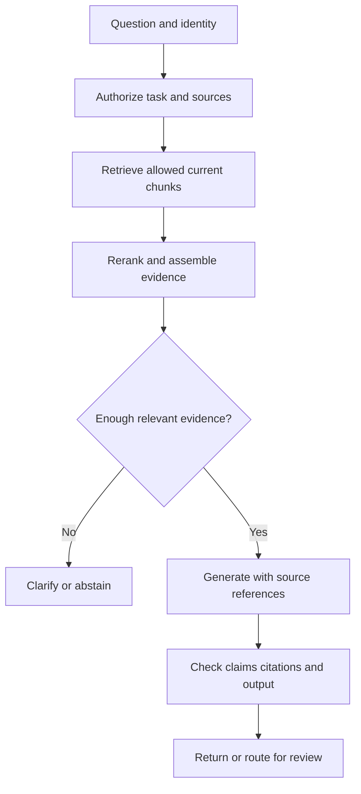

# 13 · Design a production RAG system

**Prerequisites:** Chapters 7 and 10–12. **Goal:** connect retrieval, generation, evidence, and access control into one system.

## RAG in one sentence

Retrieval-augmented generation fetches relevant material and gives it to a generative model as context. It can improve access to current or private knowledge, but it does not automatically make an answer correct.

**Everyday intuition:** an open-book exam helps only if you find the right page, read the exception, and answer the actual question.

## Separate ingestion from answering

The ingestion path prepares versioned evidence. The serving path uses authenticated identity and a question to select permitted evidence and compose an answer. Mixing expensive document processing into every question makes freshness, latency, and failure recovery harder to manage.

## Work through one request

A user asks, “Can opened electronics be returned after 20 days?” The retriever finds a general 30-day returns page and a section specifying a 14-day limit for opened electronics. Both sources matter. A top-one retrieval approach might give a confidently wrong general answer.

The context builder should include the relevant exception, document identity, version, and reference labels. The response should state the applicable condition and cite the supporting span. If product type or purchase date is missing, the system should ask for it rather than inventing eligibility.

## Grounding and citations

A citation is useful only if the cited material supports the nearby claim. A link to a document that merely contains the same keyword is insufficient. Evaluate claim support and citation correctness separately from answer style.

An automated checker can verify that citation IDs exist in the supplied context. That detects invented IDs, but not subtle contradictions or unsupported interpretations. Use labeled examples and human review to calibrate more advanced checks. A second model can help but can also repeat the first model's error.

## Permissions and freshness

Authenticate before retrieval. Derive tenant and access scope from trusted identity. Apply access restrictions in the data layer, then check again before serializing context or returning source links. Avoid putting unauthorized candidates in logs or traces. A model instruction to “ignore private documents” does not implement isolation.

Use document versions in retrieval, citations, and cache keys. Define a maximum freshness delay and measure it. A policy answer must be explainable in terms of the policy version actually used, not whatever happens to be current when somebody investigates later.

## Advanced patterns, only when needed

**Query rewriting** can clarify vague language but may change intent; preserve and evaluate the original question. **Multi-query retrieval** can increase coverage while adding cost and duplicates. **Graph retrieval** can help relationship-heavy questions when entity extraction and graph maintenance are reliable. It is unnecessary for many ordinary document questions.

**Agentic retrieval** lets a model choose additional searches. It is useful for multi-step discovery but needs search-count, time, and cost limits plus a stopping rule. **Multimodal retrieval** can find images, tables, and diagrams but requires appropriate representations and a way to cite those regions. Each pattern adds failure modes and evaluation work.

Long-context prompting is an alternative when the eligible source set is small enough. Compare it against retrieval on quality, latency, cost, update behavior, and access boundaries. RAG and long context are architectural choices, not competing identities.

## A release gate

Test answerable, unanswerable, conflicting, stale, adversarial, and permission-denied cases. Inspect retrieval recall, grounded answer correctness, citation support, abstention behavior, latency, and cost. Do not compress them into a single reassuring number.

## Practice and answer

**Question:** recall is high, but grounded answer accuracy is low. What next?

**Answer:** inspect whether the relevant chunks actually enter the final context, whether exceptions are preserved, whether truncation removes evidence, and whether the prompt/model uses that evidence correctly. Retrieval success is only one stage of the pipeline.

Build: [local retrieval lab](../labs/README.md). Apply: [support assistant case](../case-studies/01-support-assistant.md).

Next: [Workflows and agents](14-workflows-and-agents.md) · [Index](../INDEX.md)
