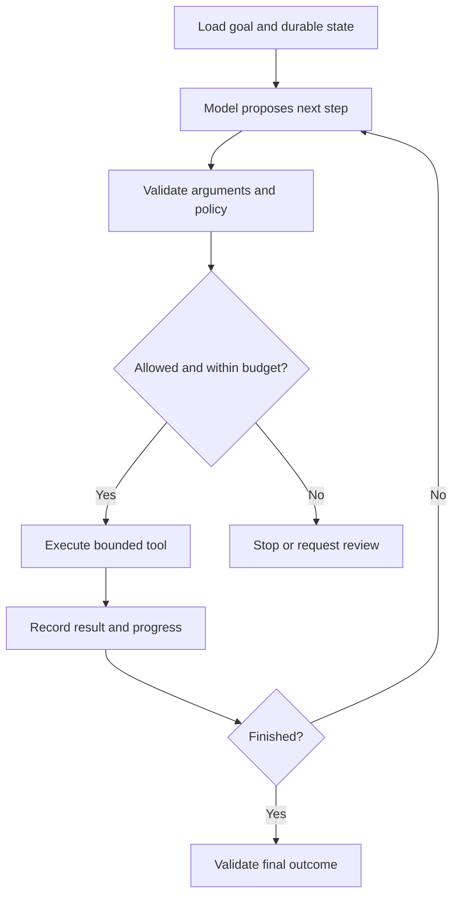

# 14 · Workflows, agents, and bounded autonomy

**Prerequisites:** Chapters 4 and 7. **Goal:** choose how much control to give a model.

## A workflow has a predefined route

A workflow follows application-defined steps: receive invoice, extract fields, validate, request approval, then create a record. Some steps can use models without making the whole system autonomous. An agent uses model output to choose some of its next steps or tools within an application-controlled environment.

**Everyday intuition:** a checklist tells a technician exactly which steps to follow. An investigator chooses the next question from what they have learned. Both still need authority limits.

Use a workflow when the process is well understood. Consider an agent when the next useful action depends on information discovered during execution and a fixed route would be unwieldy. More autonomy introduces more possible trajectories to test.

## Common patterns

| Pattern | Mechanism | Example | Main cost |
|---|---|---|---|
| Chaining | Output from one step feeds the next | Extract, validate, summarize | Errors propagate downstream |
| Routing | Choose a specialized path | Billing versus technical support | Router errors |
| Parallel independent work | Run separable tasks concurrently | Extract from unrelated files | Concurrency and spend |
| Planner/executor | Propose steps, then perform allowed steps | Research several permitted sources | Plan quality and state tracking |
| Critic/revision | Check an output and improve it | Review a draft against a rubric | Repeated shared mistakes |

These are engineering patterns, not requirements to create many named agents. A function call or ordinary state machine often implements them clearly.

## The controlled loop

The application owns the loop. It enforces maximum steps, wall time, token/cost budget, allowed tools, output size, and cancellation. A model saying “I am done” is not enough if the required artifact or transaction does not exist.

## Tool results are observations

Keep a compact durable record of proposed actions, validated arguments, execution IDs, outcomes, and errors. Tool output may contain untrusted text. Do not allow a webpage or email to rewrite the agent's authority simply because it appears in an observation.

If the agent repeats the same unsuccessful search, detect lack of progress. Stop with a useful partial result or escalation rather than consuming the entire budget. Define completion using observable conditions: a reviewed draft exists, the report passes validation, or all requested source IDs were processed.

## Multiple agents

Separate agents can help when tasks truly need different context, parallel independent investigation, or distinct permissions. They also add coordination, repeated context cost, inconsistent assumptions, and more difficult debugging. A second agent is not an independent verifier merely because it has a different name.

Start with one controlled workflow. Add another worker only when a measured bottleneck or clear authority boundary justifies it. Do not use an agent to bypass a deterministic check you could implement directly.

## Practice and answer

**Question:** should invoice posting be delegated to an open-ended finance agent?

**Answer:** usually begin with a fixed extraction/validation/review/posting workflow. Let a model handle ambiguous language or suggest resolutions. Keep vendor identity, duplicate checks, totals, approval, and the final external write under explicit application controls.

Further reading: [Anthropic's workflow/agent distinction](https://www.anthropic.com/engineering/building-effective-agents). The article's original patterns are conceptually useful; its historical tool examples should not be treated as current API documentation.

Next: [Tools and MCP](15-tools-and-mcp.md) · [Index](../INDEX.md)
