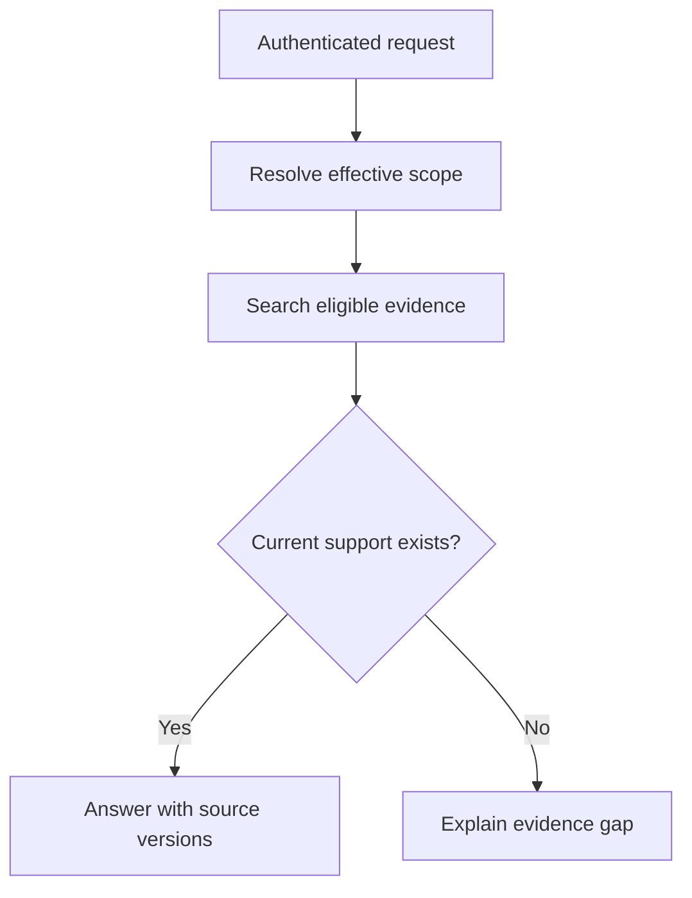

# 01: Authorized retrieval

## Start with the constraint

An internal assistant answers policy questions for several teams. Two documents can be semantically similar while belonging to different tenants or permission groups. A correct answer must use evidence the caller is allowed to access, and the evidence must be current enough for the question.

**Invariant:** unauthorized text never enters the caller's model context or response cache.

## Design choices

Carry trusted tenant, user scope, and policy version independently of user-supplied prompt text. Enforce eligibility in the retrieval path before material reaches the model. Preserve document IDs, version, and permitted source locations. If the store cannot enforce the required filter, isolate indexes or introduce a trusted eligibility layer; do not quietly weaken the invariant.

Version-aware ingestion and invalidation matter as much as vector ranking. A superseded policy with a high similarity score is still the wrong policy. Treat an unsupported question as a legitimate output path.

## Where it fails

A cache keyed only by question can return an administrator's answer to a member. Tenant-level filtering can still leak documents between groups inside that tenant. A document can be revoked after a request begins. Retrieved text can contain instructions that should not become tool permissions. Citing an inaccessible source does not undo disclosure.

## Measure and practice

Track retrieval support, answer support, denied-scope failures, stale-evidence behavior, and refusal usefulness separately. Latency and cost are additional constraints, not replacements for these checks.

Build six synthetic documents across two tenants, two roles, and two policy versions. Ask identical questions from different identities. Revoke access and repeat with a warm cache. Verify the actual model input and returned evidence IDs without placing sensitive text in routine logs.

Supporting implementation candidates: [pgvector](https://github.com/pgvector/pgvector), [Qdrant](https://github.com/qdrant/qdrant), and [Haystack](https://github.com/deepset-ai/haystack). A library choice alone does not establish the invariant.

Back: [pattern index](../README.md).
