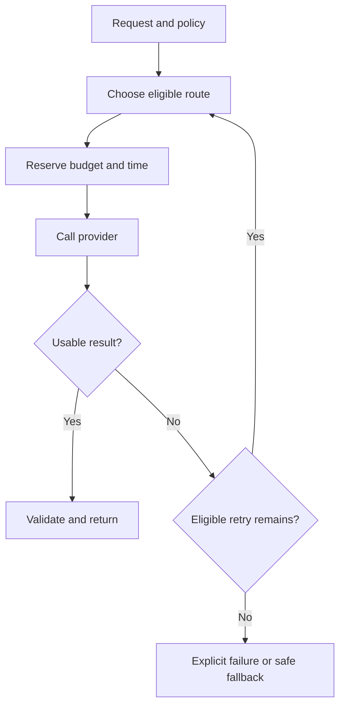

# 02: A model gateway that preserves constraints

## Start with the constraint

A provider is slow, so the application switches models. The replacement might cost more, have a different context window, or be outside the permitted data route. Availability improves only if fallback preserves the request's actual constraints.

**Invariant:** retries and fallback remain inside the original deadline, spending limit, and permitted data destinations.

## Design choices

Maintain a request deadline rather than resetting a full timeout on every attempt. Estimate cost before dispatch, then reconcile observed usage. Separate retryable transport failures from invalid inputs and policy denial. Bound retries, add appropriate backoff, and stop when the remaining time cannot support useful work.

Normalize provider responses carefully. A syntactically valid result can be empty, truncated, or missing required fields. Record the chosen route and failure reason so a quality regression is not hidden behind a successful HTTP status.

## Where it fails

Nested SDK and gateway retries multiply attempts. A circuit breaker with one global key can suppress healthy regions or tenants. Changing providers can alter output quality. Retrying a tool-calling response without handling side effects can repeat an action. A cheapest-first strategy can increase total cost when it produces more failed tasks.

## Measure and practice

Measure completed-task quality, deadline misses, spend per completed task, attempt count, and route-specific errors. Compare distributions; a good median can hide repeated slow fallback paths.

Simulate three routes with different latency, failure, cost, and data eligibility. Give one synthetic request a tight deadline and a disallowed backup route. The expected behavior may be an explicit failure. Confirm the simulator never routes to the disallowed provider merely because it is available.

Supporting reading: [OpenTelemetry Python](https://github.com/open-telemetry/opentelemetry-python) for instrumentation. The companion catalog separately describes the license scope of gateway candidates such as LiteLLM.

Back: [pattern index](../README.md).
