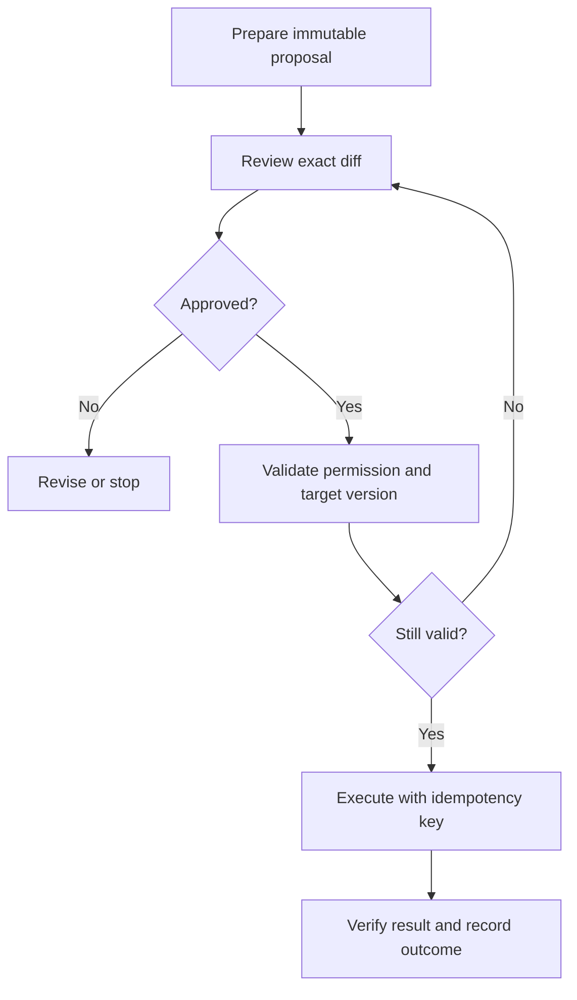

# 03: Approval bound to a reviewed action

## Start with the constraint

An assistant drafts a change, a person approves it, and a background worker executes later. Between review and execution, the payload or target may change. A generic “approved” flag does not prove that the current write was reviewed.

**Invariant:** the executed action matches the approved actor, target, payload, scope, and validity window.

## Design choices

Store the proposal version or digest with the reviewer decision. Revalidate execution-time permissions and the target version. A changed payload needs a new review when it changes what the person authorized. Include a stable operation ID in the execution record so retries can reconcile with earlier attempts.

When a remote service supports idempotency keys or conditional writes, use those semantics and verify their scope and expiry. A local database transaction cannot make an unrelated external API atomic. If a network timeout leaves the result unknown, check the remote result before assuming the action failed and retrying.

## Where it fails

The worker executes a newer draft using an older approval. A retry creates a second record. An expired reviewer session is treated as current permission. The system says “done” after submitting a request but never verifies the resulting state. Cancellation races with a queued worker.

## Measure and practice

Track stale-approval rejection, duplicate effects, unknown outcomes, review delay, and completion verification. Keep the human review understandable: summarize the actual change and show consequential fields.

Simulate a draft update after approval, a target-version conflict, duplicate delivery, and a timeout after a successful remote write. For each, write down the expected persisted state. Use a local fake service before connecting a real account.

Supporting candidates: [LangGraph](https://github.com/langchain-ai/langgraph) for explicit workflow control and [Pydantic](https://github.com/pydantic/pydantic) for data contracts. Neither replaces authorization or remote idempotency guarantees.

Back: [pattern index](../README.md).
