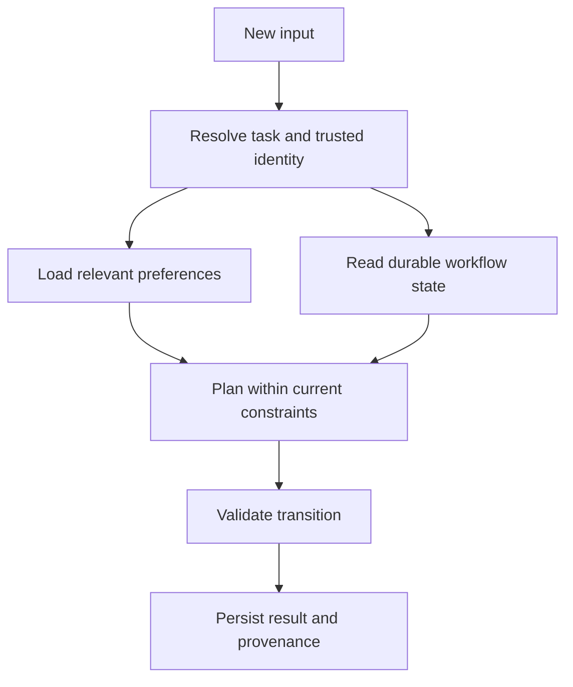

# 04: Separate helpful memory from workflow state

## Start with the constraint

An assistant remembers that the user prefers a short summary. It also needs to know whether a reviewed export finished. These facts require different storage and correction behavior.

**Invariant:** a conversational summary cannot become authoritative proof that an action occurred or remains authorized.

## Design choices

Use memory for useful preferences and contextual summaries, with provenance, expiry, and a way to correct them. Store execution state in explicit records: task ID, status, version, operation ID, last verified result, and next valid transitions. Prefer event records or versioned state when audit and replay matter.

Retrieve only relevant memory. A prior request for a weekly brief does not establish a new permission to email recipients. When a user corrects a fact, identify affected plans and derived artifacts rather than merely appending the contradiction to a longer summary.

## Where it fails

A summary says “sent” although only a draft exists. An interrupted worker resumes from an invented completion. Two agents overwrite the same task state. A stale preference overrides the user's current instruction. A deleted source survives in copied memory without retention handling.

## Measure and practice

Test correction propagation, stale-memory use, missing provenance, conflicting updates, and restart behavior. Assess whether the user can understand and correct what the assistant retains.

Create a synthetic task with planned, awaiting-review, executing, completed, and failed states. Crash between execution and acknowledgment. Resume from durable records and reconcile the effect. Then change a remembered preference and confirm that it affects formatting without altering permissions or completed-action records.

Supporting candidate: [LangGraph](https://github.com/langchain-ai/langgraph). Check current persistence behavior and the backing store rather than assuming every graph automatically has durable state.

Back: [pattern index](../README.md).
