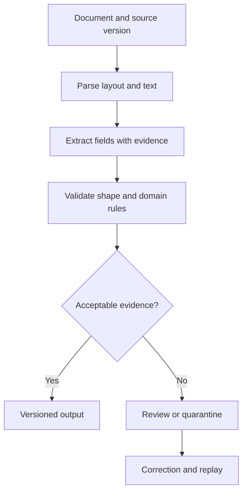

# 05: Document ingestion with visible uncertainty

## Start with the constraint

A document pipeline extracts an amount, date, and account reference. Every field fits its schema, but the parser attached the amount from the next table row. Valid JSON is not enough.

**Invariant:** an accepted record has traceable source evidence and passes domain checks appropriate to its use.

## Design choices

Preserve source identity, page, coordinates or source spans, parser version, and extraction version. Apply schema checks and meaningful cross-field checks. A date can be well-formed but outside the allowed period; a line-item sum can contradict a total. Separate uncertainty requiring review from structurally invalid input requiring rejection.

Use a stable document identity plus content/version information for replay. A corrected document should not silently overwrite the evidence for an older accepted record. Design review queues with owners and capacity limits; a pipeline that sends everything to review may simply move the bottleneck.

## Where it fails

Merged cells break row association. OCR changes an identifier. Duplicate uploads create duplicate downstream effects. A model's self-reported confidence is treated as a calibrated probability. Retrying with another parser changes field meanings without updating provenance.

## Measure and practice

Evaluate field accuracy, record acceptance error, review volume, correction time, and duplicate effects. Segment by document layout and scan quality. A good average on clean text PDFs does not prove performance on scanned tables.

Create three synthetic documents containing a multi-page table, a missing total, and a duplicated upload. Define expected output and evidence locations by hand. Compare extraction errors before choosing a parser. Add one deliberately plausible wrong field and verify that the review flow catches it.

Supporting candidates: [Docling](https://github.com/docling-project/docling), [Unstructured](https://github.com/Unstructured-IO/unstructured), and [PaddleOCR](https://github.com/PaddlePaddle/PaddleOCR). Read model and data terms separately from library licenses.

Back: [pattern index](../README.md).
