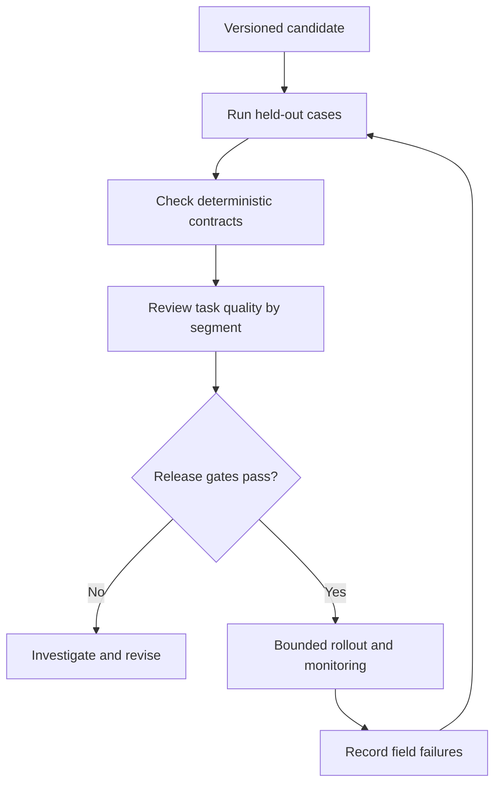

# 06: Evaluation as a release decision

## Start with the constraint

A prompt change improves common answers while making missing-evidence responses less reliable. One aggregate score hides the trade-off.

**Invariant:** a release decision considers required segments and hard constraints, not just one average.

## Design choices

Keep development examples separate from held-out evaluation. Version prompts, model settings, tool contracts, retrieval data, and the evaluation dataset. Use deterministic checks where the expected property is exact. Use expert review or model-assisted grading for subjective qualities, but inspect grader false passes and disagreements.

Define what blocks release before seeing the candidate's score. For example, an exercise might permit no denied-scope disclosures in its suite while requiring a minimum supported-answer rate. Those thresholds are local design decisions, not universal safety guarantees. Report sample sizes and unresolved uncertainty.

## Where it fails

The team edits test cases to fit the new answer. A grader rewards fluent unsupported text. Only completed responses are counted, hiding timeouts. A model upgrade changes the judge and the candidate simultaneously. A small suite's perfect result is described as proof that the system cannot fail.

## Measure and practice

Report per-segment quality, abstention behavior, invalid outputs, failures, full task latency, and cost. Compare the same versioned cases where possible. Document manual overrides and why they happened.

Create 20 synthetic cases across supported, missing-evidence, denied-action, and dependency-failure segments. Make one candidate improve the common segment while violating a hard gate. Produce a no-go decision that remains understandable to a non-engineer. Add failure reproductions without contaminating the remaining held-out set.

Supporting candidates: [Ragas](https://github.com/vibrantlabsai/ragas), [DeepEval](https://github.com/confident-ai/deepeval), and [Promptfoo](https://github.com/promptfoo/promptfoo). Tool output still needs interpretation against the task contract.

Back: [pattern index](../README.md).
