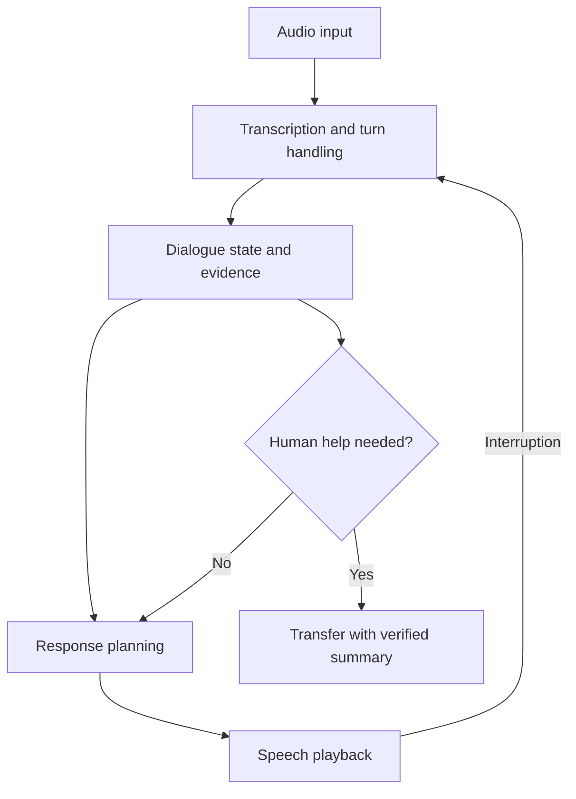

# 07: Voice interaction with correction and handoff

## Start with the constraint

A caller interrupts an assistant while it speaks an incorrect order reference. The system must stop playback, capture the correction, and avoid acting on the earlier value.

**Invariant:** interrupted or corrected speech does not silently remain the basis for a consequential action.

## Design choices

Track turn IDs and distinguish partial from final transcripts. Cancel obsolete playback and pending work when an interruption invalidates it. Confirm consequential identifiers through an appropriate workflow; a plausible transcript is not proof of correctness. Provide an accessible text or human path when speech recognition fails repeatedly.

A useful handoff includes verified facts, open questions, attempted steps, and the caller's requested outcome. Label uncertain transcripts. The receiving human should not have to infer whether an action was executed from conversational wording.

## Where it fails

The assistant answers a previous turn after a correction. Background audio triggers a false intent. Word error rate looks good while names and identifiers remain wrong. Transfer fails and the user is left in a silent call. A disconnected session later completes an action the user abandoned.

## Measure and practice

Measure time to first useful audio, interruption-stop latency, end-to-end task time, critical-entity errors, successful handoffs, and unresolved disconnects. Audio quality, language, and device conditions should be visible in the report.

Use synthetic or permitted recordings. Test a corrected identifier, overlapping speech, long silence, an unavailable human queue, and disconnect during a pending action. Record whether the final state matches the caller's last verified intent.

Supporting candidates: [Whisper](https://github.com/openai/whisper), [LiveKit Agents](https://github.com/livekit/agents), and [Pipecat](https://github.com/pipecat-ai/pipecat). Their library licenses do not establish rights to every voice, recording, or model.

Back: [pattern index](../README.md).
