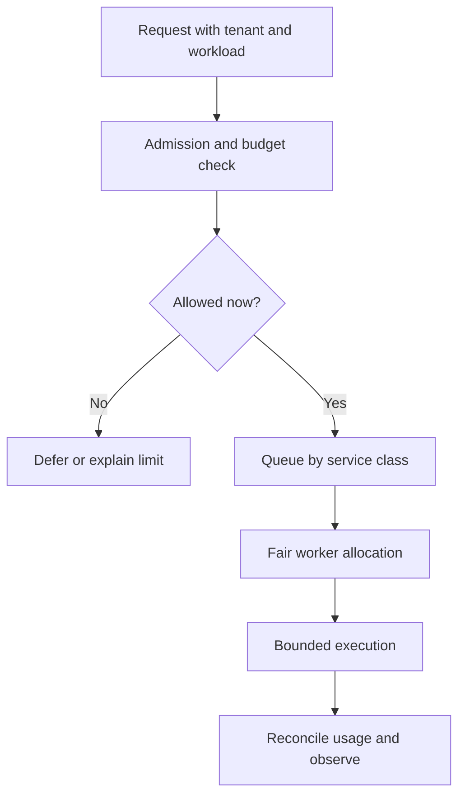

# 08: Tenant budgets and fair service

## Start with the constraint

One tenant uploads a large document set. Its background jobs occupy every worker, and short interactive questions from other tenants wait. Infrastructure is available, but the service is unfair and expensive.

**Invariant:** each task is admitted and scheduled within explicit resource limits, while other eligible tenants retain service capacity.

## Design choices

Separate interactive and batch workloads where appropriate. Bound concurrency, queue age, input size, and per-task work. Reserve estimated budget before expensive execution and reconcile actual usage. State what happens when an estimate is wrong: stop, request a revised budget, or defer remaining work.

Fair scheduling can use per-tenant queues, weighted allocation, or capacity reservations. Choose a policy that matches the product promise and operational constraints. Document cancellation and refund/reconciliation behavior so abandoned work does not consume unbounded resources.

## Where it fails

Small requests wait behind one huge batch. Retries bypass budget accounting. Token limits are enforced while expensive tool calls are ignored. A shared cache reveals another tenant's result. Backpressure only appears as timeouts, causing clients to retry harder.

## Measure and practice

Track queue delay and completed-task latency by tenant and workload class, spend per completed task, rejected/deferred work, cancellations, and reconciliation error. A low global average can coexist with starvation for a small tenant.

Simulate three tenants: one large batch, one steady interactive stream, and one bursty stream. Compare a single first-in queue with a bounded fair policy. Include retry and cancellation. Report who waits, how long, and what work is explicitly deferred. Avoid treating the simulator's timing as a production benchmark.

Supporting candidates: [Prefect](https://github.com/PrefectHQ/prefect), [Dagster](https://github.com/dagster-io/dagster), and [Airflow](https://github.com/apache/airflow). Verify current queue and concurrency semantics before implementing a scheduling policy.

Back: [pattern index](../README.md).
