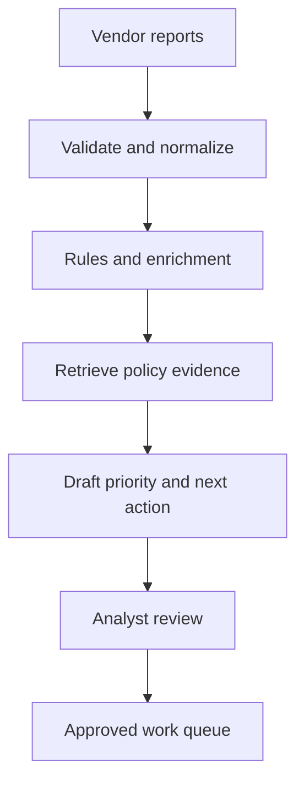

# Project 01 — RCM Denial Intelligence Copilot

## Customer simulation

A medical-practice revenue-cycle team receives denial reports from multiple payers and vendors. Analysts manually normalize reason codes, locate evidence, prioritize cases, and draft next actions. Data is fragmented and recommendations must remain reviewable.

Use only synthetic, de-identified, or explicitly authorized data. This educational project does not establish HIPAA compliance.

## Target outcome

Reduce analyst triage time per eligible denial while maintaining evidence coverage and zero unauthorized record access. Treat this as a hypothesis until a pilot measures it.

## Vertical slice

Build one input adapter, a canonical denial schema, deterministic validation, evidence retrieval, a structured recommendation, and a review queue. Every recommendation must cite the source rule or policy version and show uncertainty.

## Evaluation set

Include at least 60 cases across:

- common and rare denial categories;
- missing or contradictory fields;
- duplicate and resubmitted records;
- outdated and conflicting policy documents;
- access-restricted practice or payer data;
- no-action, escalate, and insufficient-evidence outcomes.

Measure schema-valid rate, category accuracy, evidence recall, citation validity, appropriate abstention, priority agreement, p95 latency, and cost per accepted case. Review false high-priority recommendations separately because their operational cost differs.

## Security and control requirements

- role and practice-scoped authorization before retrieval;
- field-level data classification and redaction;
- encrypted storage and transport;
- retention/deletion decisions for raw files, embeddings, prompts, and traces;
- analyst approval before work-queue creation;
- immutable record of input version, evidence, model/prompt, reviewer, and disposition.

## Failure drill

Inject a vendor schema change, retrieval outage, duplicate file, and recommendation quality regression. The system must quarantine invalid input, continue safe deterministic processing where possible, prevent duplicate cases, and alert on quality drift.

## Demo storyline

Show a messy report entering the system, one valid case receiving a cited recommendation, one unauthorized case being blocked, one insufficient-evidence case escalating, and the operational dashboard updating.

## Portfolio evidence

- before/after workflow and baseline math;
- canonical data contract and provenance;
- retrieval/evaluation report by denial slice;
- threat model, access matrix, and retention note;
- incident timeline and analyst runbook;
- ROI model separating time capacity from realized cash impact.
