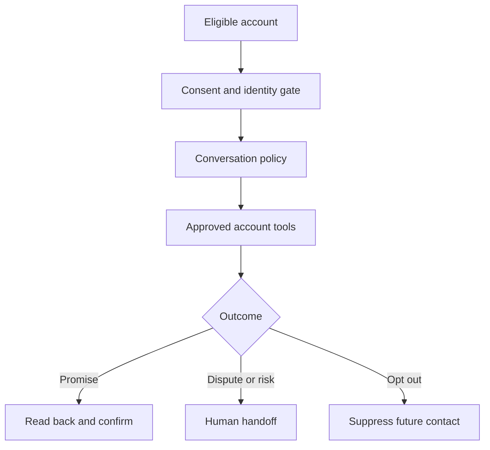

# Project 02 — Collections Voice Agent

## Customer simulation

A finance operations team spends significant time on routine payment reminders. It wants a voice agent that can verify context, discuss approved options, record a promise-to-pay, and hand sensitive or disputed cases to a person.

Applicable calling, recording, consent, debt-collection, and privacy rules vary by jurisdiction. Treat legal approval as a deployment dependency, not a prompt instruction.

## Target outcome

Increase completed, policy-compliant conversations per operating hour while preserving opt-out, escalation, and audit requirements. A promise is not collected cash; measure both separately.

## Vertical slice

Use a telephony simulator or sandbox. Implement eligibility, calling window, identity/consent, approved message policy, read-only account lookup, reversible promise capture, immediate opt-out, and warm handoff.

## Evaluation set

Build scripted and adversarial conversations covering silence, accents/noise, interruption, confused identity, third-party answer, hardship, dispute, anger, prompt injection, unsupported negotiation, opt-out, provider timeout, and tool failure.

Measure consent compliance, correct identity handling, unsupported-commitment rate, escalation recall, opt-out latency, task completion, interruption recovery, end-to-end latency, cost per compliant completed call, and promise-to-payment conversion where measurable.

## Safety controls

- no account details before identity/consent policy passes;
- allowlisted phrases and ranges for regulated/high-risk commitments;
- no model-created fees, threats, deadlines, or unsupported offers;
- immediate suppression tool with confirmation;
- step, duration, and spend limits;
- human takeover and kill switch;
- recording/transcript handling based on approved policy.

## Failure drill

Drop the call during promise capture, repeat the telephony event, and fail the CRM write. Prove that the system does not create duplicate commitments and that uncertain state goes to review.

## Demo storyline

Run three short calls: successful reminder and confirmed promise, a disputed account with warm handoff, and an opt-out that immediately updates suppression. Show the audit timeline and masked observability view.

## Portfolio evidence

- conversation state machine and policy matrix;
- latency budget by component;
- test-call dataset and safety report;
- tool permissions and consent data flow;
- partial-failure/reconciliation runbook;
- outcome funnel from dial to compliant conversation to realized payment.
