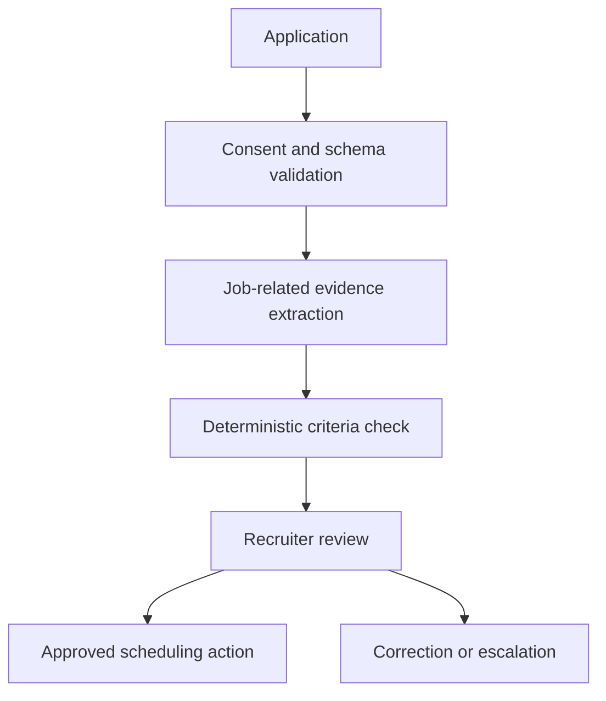

# Project 03 — Recruiting Operations Agent

## Customer simulation

A recruiting team receives applications across multiple sources, manually structures job-related evidence, coordinates screens, and loses time to duplicate records and incomplete handoffs. The system must support recruiters without making autonomous employment decisions.

## Target outcome

Reduce administrative cycle time and incomplete handoffs while keeping final screening and hiring decisions with authorized humans.

## Vertical slice

Build one application intake path, duplicate detection, typed extraction, explicit job-criteria mapping, recruiter review, correction capture, and calendar/sandbox scheduling. Store which source evidence supports each extracted claim.

## Evaluation set

Create synthetic resumes and applications varying format, career gaps, non-traditional experience, multilingual text, missing information, conflicting dates, name ambiguity, disability-related content, and prompt injection embedded in documents.

Measure extraction accuracy per field, unsupported-inference rate, evidence-link validity, duplicate precision/recall, criteria mapping agreement, recruiter correction rate, time per reviewed candidate, scheduling success, and access violations.

Slice results by document format and other operationally relevant factors. Do not infer or score protected characteristics. Obtain appropriate legal and responsible-AI review for real use.

## Control requirements

- minimize collected fields and separate sensitive voluntary data;
- no autonomous reject or rank action;
- show job-related evidence and uncertainty to the reviewer;
- log reviewer and rationale for workflow decisions;
- permission-bound candidate and role access;
- retention, deletion, correction, and appeal process;
- approved calendar and communication templates only.

## Failure drill

Introduce a resume with malicious instructions, duplicate identity with conflicting details, expired recruiter access, and calendar provider failure. Confirm safe blocking, review routing, and idempotent scheduling.

## Demo storyline

Show intake of two duplicate applications, transparent evidence extraction, a recruiter correction that becomes an eval case, approval-based scheduling, and a malicious document being quarantined.

## Portfolio evidence

- current/future workflow and decision-rights map;
- synthetic dataset card and evaluation slices;
- model card/ADR explaining prohibited uses;
- reviewer interface and correction loop;
- privacy/security control matrix;
- measured admin-time outcome without claiming hiring-quality causation.
