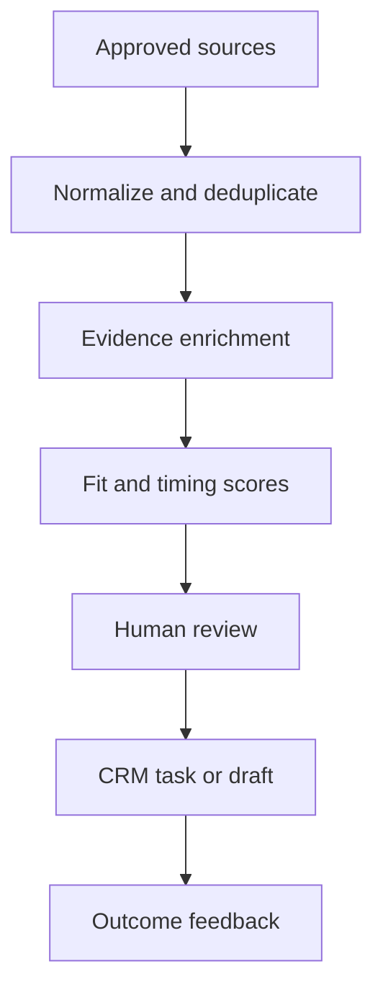

# Project 04 — B2B Lead Intelligence System

## Customer simulation

A small B2B team wastes time researching poorly matched accounts and sending generic outreach. It needs a pipeline that identifies a narrow market, preserves source evidence, scores fit transparently, and creates review-ready outreach tasks.

## Target outcome

Increase qualified conversations per 100 reviewed accounts while respecting data source terms, suppression, contact preferences, and outreach law.

## Vertical slice

Choose one industry and one buyer role. Ingest 100 synthetic or permitted account records, enrich from documented sources, preserve source URL/time/field provenance, compute interpretable fit and timing scores, and create a CRM task or draft only after review.

Do not implement bulk sending. The engineering problem is selection quality and auditability, not volume.

## Evaluation set

Include clear matches, clear non-matches, subsidiaries, duplicate domains, stale evidence, conflicting sources, missing fields, consultants/agencies, and suppressed accounts.

Measure duplicate rate, field freshness, provenance coverage, fit precision at the review cutoff, reviewer acceptance, false-positive reasons, suppression violations, research time per accepted account, and qualified conversations per reviewed account.

## Controls

- document source license/terms and collection method;
- maintain do-not-contact and customer suppression before task creation;
- expose evidence and reason codes for each score;
- prohibit fabricated personalization and inferred sensitive traits;
- limit frequency and daily volume;
- preserve manual approval for external communication;
- support correction, deletion, and stale-data expiration.

## Failure drill

Simulate an enrichment outage, source schema change, duplicate legal entities, stale trigger event, and a suppressed contact. The pipeline must degrade visibly and never bypass suppression.

## Demo storyline

Show one high-fit account with fresh evidence, one misleading account being rejected by the reviewer, a duplicate being merged, and a suppressed account blocked before any draft/task is created.

## Portfolio evidence

- ICP/problem brief and source register;
- canonical account/contact schema;
- scoring ADR and threshold evaluation;
- provenance and suppression tests;
- funnel dashboard from input to qualified conversation;
- outcome review separating correlation from attribution.
