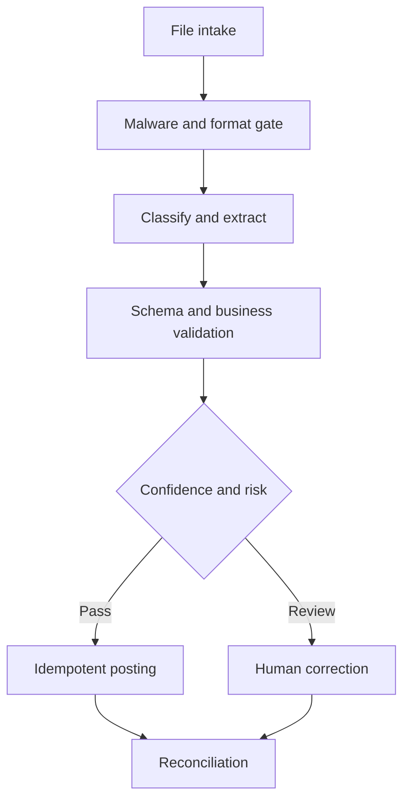

# Project 05 — Document Operations Pipeline

## Customer simulation

An operations team receives invoices, forms, contracts, and reports in inconsistent formats. Staff manually classify, extract, validate, enter, and reconcile records. Silent field errors create more risk than visible processing failures.

## Target outcome

Increase straight-through processing for eligible documents while keeping critical-field error and duplicate-posting rates below agreed thresholds.

## Vertical slice

Support two document classes and one destination sandbox. Keep the original file hash, parser/model version, typed fields, evidence location, confidence, validation results, reviewer corrections, posting ID, and reconciliation state.

## Evaluation set

Create at least 80 permitted or synthetic documents across clean digital files, scans, rotation, handwriting, multi-page layouts, missing pages, duplicate files, conflicting totals, unfamiliar templates, malicious embedded instructions, and password-protected inputs.

Measure classification accuracy, exact match per critical field, numeric/date normalization, table completeness, validation catch rate, review rate, straight-through rate, duplicate prevention, cost per reconciled document, and p95 processing time.

Use field-level thresholds: an address typo and an incorrect bank account number are not equivalent errors.

## Controls

- file allowlist, size/page limits, malware scan, and quarantine;
- isolated parsing and no execution of embedded content;
- business-rule validation and cross-field reconciliation;
- human review for low-confidence or high-impact fields;
- idempotency key based on stable business identity, not only filename;
- role-based access, retention, redaction, and deletion;
- destination reconciliation before marking success.

## Failure drill

Change a vendor template, send the same document twice under different names, corrupt one page, and fail after destination write. Demonstrate quarantine, duplicate prevention, uncertain-state review, and reconciliation.

## Demo storyline

Process a clean invoice automatically, route a damaged form to review with evidence highlighting, block a malicious file, and safely replay a destination timeout without a duplicate posting.

## Portfolio evidence

- document dataset card and license/provenance;
- typed schemas and criticality map;
- field-level evaluation dashboard;
- validation and idempotency tests;
- reviewer correction workflow;
- operations runbook and reconciliation report.
