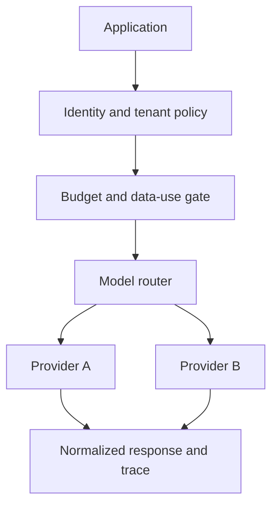

# Project 06 — Enterprise AI Control Plane

## Customer simulation

Several teams call different model providers directly. Security cannot see data flows, finance cannot attribute spend, and application teams reinvent retry, policy, and telemetry. The platform team needs a thin control plane without becoming a delivery bottleneck.

## Target outcome

Give application teams one reliable interface for approved models, policy, budgets, and telemetry while preserving tenant isolation and a provider exit path.

## Vertical slice

Implement a small gateway with authenticated tenants, approved model aliases, structured request/response schemas, data classification flags, per-tenant budgets, provider adapters, timeouts, retries, circuit breaking, and OpenTelemetry traces.

Do not attempt to wrap every provider feature. Define an escape hatch and governance process for unsupported capabilities.

## Evaluation set

Test schema compatibility, model routing, provider timeout/rate limit, malformed output, budget exhaustion, policy denial, prompt injection metadata, tenant-ID tampering, concurrent requests, and provider response drift.

Measure availability, routing correctness, policy decision accuracy, cross-tenant violations, p50/p95 latency overhead, cost attribution coverage, fallback success, normalized-schema validity, and developer integration time.

## Controls

- trusted identity supplies tenant context; callers cannot override it;
- allowlisted models/tools per tenant and data class;
- prompts and responses excluded or redacted from default logs;
- per-tenant rate, token, and cost budgets;
- signed/versioned policy and audit events;
- provider credentials isolated from application teams;
- emergency deny, provider disable, and global kill switch;
- retention and deletion controls for telemetry.

## Failure drill

Fail the preferred provider, corrupt one adapter response, exhaust a tenant budget, rotate a provider secret, and attempt cross-tenant trace access. Verify safe routing/denial and useful operator alerts.

## Demo storyline

Show two tenant applications using one model alias under different policies, transparent provider fallback, a budget denial, masked traces and cost allocation, then a cross-tenant access attempt blocked and audited.

## Portfolio evidence

- tenancy and trust-boundary architecture;
- API/adapter contracts and compatibility tests;
- routing, budget, and data-policy ADRs;
- SLOs and failure-injection report;
- cost allocation dashboard;
- developer onboarding and provider-escape guide.
